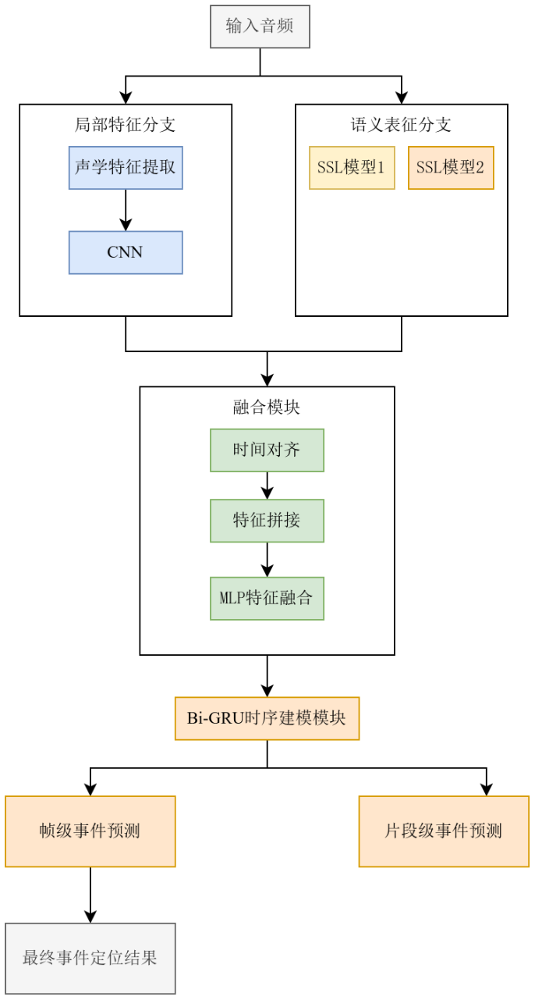

# 异构自监督模型互补融合的声音事件检测

**Heterogeneous Self-Supervised Representation Fusion for Sound Event Detection** · DCASE 2022 Task 4 / DESED

[](https://www.python.org/)
[](https://pytorch.org/)
[](LICENSE)

本仓库是本科毕业设计《异构自监督模型互补融合的声音事件检测研究》的完整实现。它把 DCASE 2022 Task 4 官方开源的**单体 CRNN baseline**重构成「编码器 → 时间对齐 → 共享解码器」的可插拔框架，让 CRNN、BEATs、WavLM 三类异构表征可以在同一任务、同一数据、同一标签栅格、同一训练与评估流程下被公平比较；在此基础上实现了特征拼接、固定式中层融合与残差门控三种融合方式，并得到了一组"互补性存在、但不全局稳定"的结论。

仓库面向两类读者：想快速了解结论的人只需要看下面的结果表与两段结论；想深挖实现的人可以从 [`docs/architecture.md`](docs/architecture.md) 进入系统设计，从 [`docs/results.md`](docs/results.md) 查看完整实验数据，从 [`docs/reproduction.md`](docs/reproduction.md) 了解环境与数据准备。

## 主要结果

下表是 DESED 合成验证集上的整体结果，指标为 PSDS1、PSDS2、Event-F1 与 Inter-F1，全部取自论文第 4 章的表 4 与表 6。

| 模型 | PSDS1 | PSDS2 | Event-F1 (%) | Inter-F1 (%) |
|---|---|---|---|---|
| CRNN（baseline） | 0.356 | 0.578 | 43.42 | 71.25 |
| BEATs（通用音频 SSL） | 0.465 | 0.780 | 52.65 | 65.80 |
| WavLM（语音域 SSL） | 0.375 | 0.678 | 45.75 | 59.80 |
| **CRNN + BEATs** | **0.522** | **0.816** | **58.64** | **74.36** |
| CRNN + WavLM | 0.362 | 0.666 | 46.75 | 62.20 |
| CRNN+BEATs+WavLM（特征拼接） | 0.486 | 0.750 | 56.25 | 77.53 |
| CRNN+BEATs+WavLM（固定式中层融合） | 0.492 | 0.734 | 55.82 | 77.41 |
| CRNN+BEATs+WavLM（残差门控） | 0.497 | 0.745 | 57.00 | 78.97 |

口径：DESED synthetic train 训练、synthetic validation 评估，强标签（`synth_only`）设定，单卡 RTX 5090（32GB），随机种子固定为 42，每种结构只训练一次。完整的类别级结果、负结果分析、典型样本时间轴与数据说明见 [`docs/results.md`](docs/results.md)。


一句话结论：**CRNN 与 BEATs 之间存在明确的互补性**，双分支把 PSDS1 从 0.356 提到 0.522、Event-F1 从 43.42% 提到 58.64%；**再引入 WavLM 后整体指标没有稳定超过双分支**，但三分支的 Inter-F1 提高了 3.05 到 4.61 个百分点——说明语音域表征改善的是时间区间覆盖，而不是完整事件检出，且这种收益是类别条件的。

## 方法



**可插拔的编码器抽象。** 三条分支最终都输出 `[B, T, D]` 的序列特征：CRNN 分支从 log-mel 频谱出发，经 CNN 得到卷积时序特征；BEATs 分支使用 vendored 的最小官方实现，可冻结也可全量微调；WavLM 分支基于 torchaudio bundle，并额外处理了官方 checkpoint 与 torchaudio 接口之间的前缀与 padding mask 差异。换前端只需要改配置里的 `model.branches`，训练与评估流程完全复用。

**显式的时间对齐。** 三路特征的时间分辨率天然不同——CRNN 来自卷积下采样，BEATs 来自 patch embedding 加 Transformer，WavLM 直接吃波形——如果不做对齐，resize 逻辑就会散落在 trainer 和 loss 里，既难以保证比较公平，也无法分析中间特征。因此框架把对齐收敛成两个显式模块：`TimeAligner` 负责把编码器序列对齐到标签栅格（支持 interpolate / nearest / adaptive_avg / adaptive_max 四种策略），`FusionTimeAligner` 负责在融合前把 SSL 序列对齐到 CNN 的时间栅格。

**融合与残差门控。** 特征拼接把三路输出沿特征维并置后交给 Merge MLP；固定式中层融合在进入后端时序模型前做一次结构化整合；残差门控则以较强的 BEATs 表示为主路径、以 CRNN 表示作为门控残差修正：

$$
\text{fused} = \text{beats\_norm} + \alpha \cdot \text{gate} \cdot \text{cnn\_norm}
$$

其中两路特征先各自经过线性投影与分支 LayerNorm 拉到同一尺度，门控网络以两路归一化特征的拼接为输入，输出通道级或帧级的门控权重；门控偏置初始化为 −1.5，使模型在训练初期贴近强基线，只有训练证明有效时才放大残差；当 `use_alpha_scale` 打开时 α 本身也是可学习参数。融合后的特征经 Merge MLP 送入共享解码器：可选的 BiGRU 做时序建模，帧级 head 给出 strong 预测，注意力池化 head 给出 weak 预测，再接均值教师半监督训练。

## 快速开始

```bash
# 1) 环境：Python 3.10 + PyTorch 2.7（cu128 运行时，论文环境见 docs/reproduction.md）
pip install -r requirements.txt

# 2) 数据：准备 DESED 合成训练集与验证集，并把 confs/experiment_unified.yaml
#    里的 data.* 路径指向本地目录（键名与官方目录结构一致）

# 3) 权重：把 BEATs、WavLM 与 CRNN warm-start 权重放到 pretrained/ 下，
#    具体文件名与获取方式见 docs/reproduction.md

# 4) 训练（默认 profile 为层级 SSL 融合路由；切到 server_a800 profile 即残差门控三分支）
python train_sed.py --conf_file confs/experiment_unified.yaml --gpus 1

# 5) 评估
python train_sed.py --conf_file confs/experiment_unified.yaml --gpus 1 \
    --test_from_checkpoint ./exp/<run_name>/version_0/<best>.ckpt
```

需要说明的是，仓库不包含训练权重和 `exp/` 结果目录，完整复现需要自行准备 BEATs 与 WavLM 的官方权重以及一份 CRNN warm-start checkpoint；上面这几条命令也没有在全新环境中做过端到端验证，细节和常见问题见 [`docs/reproduction.md`](docs/reproduction.md)。

## 仓库结构

| 路径 | 说明 | 来源 |
|---|---|---|
| `sed_modeling/` | 编码器、时间对齐、融合模块、共享解码器与模型装配（`build_sed_model`） | 本人实现 |
| `confs/` | `experiment_unified.yaml` 统一配置（含 profile 机制）与上游 baseline 配置 | 本人 / 上游 |
| `train_sed.py` | 统一训练、断点续训与评估入口（Mean-Teacher） | 在上游基础上改写 |
| `local/` | Mean-Teacher 训练器、数据工具与重采样 | 上游，改动较大 |
| `desed_task/` | DESED 数据管线、评估指标、学习率调度器与基线 CRNN | 上游 DCASE baseline |
| `scripts/` | 权重提取与后处理阈值搜索等工具 | 本人实现 |
| `tests/` | 层级融合与学习率调度的单元测试 | 本人实现 |
| `docs/` | 架构说明、实验数据、复现指南、设计记录与插图 | 本人实现 |

`sed_modeling/third_party/beats/` 是 Microsoft BEATs 官方实现的最小 vendored 子集（MIT 许可，见该目录下的 `LICENSE`），只保留特征提取所需部分，以避免引入 fairseq / hydra 等重依赖。

## 结论与局限

本文最重要的发现是一个**有分寸的负结果**：三分支融合在 PSDS、Event-F1 上没有超过强参考双分支，但 Inter-F1 提升显著，且类别层面的涨跌高度不一致（BLE、ES 提升，CAT、DOG、SPE 退化）。把这三件事放在一起，能够说明 WavLM 提供的语音域信息在时间覆盖和部分类别上确实有补充作用，但它无法稳定转化为完整事件级收益；多分支融合的关键不在于增加特征来源，而在于设计能筛掉冗余的融合机制。三种融合方式中残差门控表现相对最好，也印证了这一点。

局限同样需要讲清楚：实验只用了单随机种子、单次训练，没有多种子重复与置信区间；评估只在 DESED 合成验证集上完成，没有向 DCASE 官方测试集提交，跨域泛化尚未验证；消融并不完整，时间对齐策略、Merge MLP、门控超参数与后处理阈值的独立影响还没有逐项拆分；Event-F1 与 Segment-F1 之间的系统性差距说明边界与碎片化仍是主要误差来源，但尚未定量归因。

## 引用

如果这个仓库对你的工作有帮助，可以引用本项目的毕业论文：

```bibtex
@thesis{lixiang2026sed,
  title  = {异构自监督模型互补融合的声音事件检测研究},
  author = {李想},
  school = {安徽大学电子信息工程学院},
  year   = {2026}
}
```

本工作建立在以下开源项目与论文之上：

- **DESED / DCASE 2022 Task 4 baseline**：数据管线、评估指标与 Mean-Teacher 训练框架的来源，[DCASE-REPO/DESED_task](https://github.com/DCASE-REPO/DESED_task)
- **BEATs**：Chen et al., *BEATs: Audio Pre-Training with Acoustic Tokenizers*, 2022
- **WavLM**：Chen et al., *WavLM: Large-Scale Self-Supervised Pre-Training for Full Stack Speech Processing*, IEEE JSTSP, 2022
- **Mean Teacher**：Tarvainen & Valpola, *Mean teachers are better role models*, NeurIPS, 2017

## 致谢

本课题在安徽大学电子信息工程学院苗永春老师与科大讯飞股份有限公司企业导师的联合指导下完成，企业导师提供了方向性指导与对各模型能力边界的判断。实现过程中使用了学校与实验室提供的算力支持。

## License

本项目采用 [MIT License](LICENSE)。`desed_task/` 与 `sed_modeling/third_party/beats/` 中的代码分别来自 DCASE baseline 与 Microsoft BEATs，遵循其各自的上游许可证。
