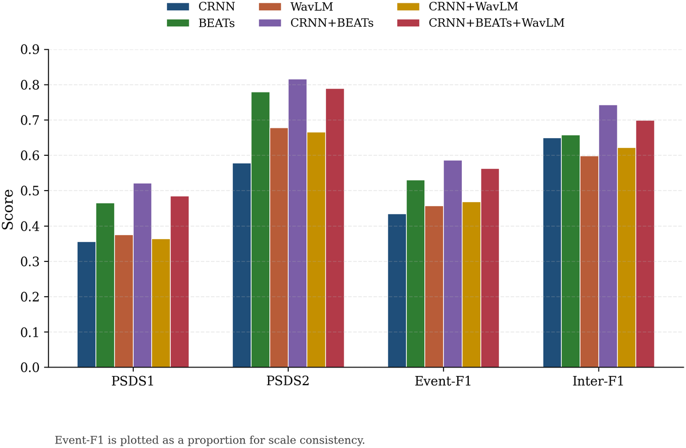

# 异构自监督模型互补融合的声音事件检测

**Heterogeneous Self-Supervised Representation Fusion for Sound Event Detection**  
DCASE 2022 Task 4 · DESED · PyTorch · MIT

这是我本科毕业设计《异构自监督模型互补融合的声音事件检测研究》的代码。DCASE 2022 Task 4 的官方 baseline 把 Mel 前端、CNN、BiGRU 和两个预测头全部写死在一个 CRNN 类里，想换前端就得连训练流程一起改。我把它拆成「编码器 → 时间对齐 → 共享解码器」三层，接进 CRNN、BEATs、WavLM 三个编码器，再比较特征拼接、固定式中层融合和残差门控三种融合方式，让三种异构表征能在同一份数据、同一个标签栅格、同一套训练和评估流程下直接比较，回答"通用音频表征和语音域表征在声音事件检测里到底能不能互补"。

结论先说：CRNN+BEATs 是这套设定下最稳的参考，PSDS1 从 0.356 提到 0.522（+46.6%），Event-F1 从 43.42% 提到 58.64%（+15.22 个百分点）。加入 WavLM 之后，三分支的 Inter-F1 最高到 78.97%（比双分支高 4.61 个点），但 PSDS 和 Event-F1 都没能超过双分支。这个负结果本身是有信息量的：WavLM 补的是时间区间覆盖，不是完整事件检出，而且收益按类别给，BLE、ES 涨，CAT、DOG、SPE 跌。

## 结果

| 模型 | PSDS1 | PSDS2 | Event-F1 (%) | Inter-F1 (%) |
|---|---|---|---|---|
| CRNN（baseline） | 0.356 | 0.578 | 43.42 | 71.25 |
| BEATs（通用音频 SSL） | 0.465 | 0.780 | 52.65 | 65.80 |
| WavLM（语音域 SSL） | 0.375 | 0.678 | 45.75 | 59.80 |
| **CRNN + BEATs** | **0.522** | **0.816** | **58.64** | **74.36** |
| CRNN + WavLM | 0.362 | 0.666 | 46.75 | 62.20 |
| CRNN+BEATs+WavLM（特征拼接） | 0.486 | 0.750 | 56.25 | 77.53 |
| CRNN+BEATs+WavLM（固定式中层融合） | 0.492 | 0.734 | 55.82 | 77.41 |
| CRNN+BEATs+WavLM（残差门控） | 0.497 | 0.745 | 57.00 | 78.97 |

口径：DESED synthetic train 训练、synthetic validation 评估，强标签（`synth_only`）设定，单卡 RTX 5090，随机种子固定为 42，每种结构只训练一次。逐类结果、负结果分析和数据口径见 [docs/results.md](docs/results.md)。



## 怎么跑

先把权重准备好。BEATs 官方权重 `BEATs_iter3+_AS2M.pt` 和本项目微调出来的 `BEATs_full_finetune_best_0_78.pt` 都放到 `pretrained/beats/` 下，后者 345 MB，在 [Releases 的 beats-fullft-v1](https://github.com/HarryWeasley3/dcase-2022-task4/releases/tag/beats-fullft-v1) 里，sha256 是 `dff86d366a70079d7e94d2da787d9d216a4cf2a418d666a25fc79c2172432fec`，`BEATsEncoder` 可以直接加载。

```bash
pip install -r requirements.txt   # Python 3.10 + PyTorch 2.7 (cu128)

# 训练：默认 profile 是 rtx_5090，单卡 5090 就能跑，跑的是论文那套三分支残差门控
python train_sed.py --conf_file confs/experiment_unified.yaml --gpus 1

# 评估
python train_sed.py --conf_file confs/experiment_unified.yaml --gpus 1 \
    --test_from_checkpoint ./exp/<run>/version_0/<best>.ckpt
```

想跑双分支，把 `model.branches.wavlm.enabled` 改成 `false` 就行，融合路由会自动切到 CRNN+BEATs 的残差门控。数据按 `confs/experiment_unified.yaml` 里 `data.*` 的键准备 DESED 合成训练集与验证集；WavLM 权重、数据目录映射、显存不够时怎么冻结分支、几个常见报错，都写在 [docs/reproduction.md](docs/reproduction.md)。

## 实现

### 编码器

三个编码器对外是同一个契约：`forward(audio)` 返回 `[B, T, D]` 的 `sequence_features`，`output_dim` 在构造时确定。CRNN 分支是 log-mel 加七层 CNN，保留了上游的频谱裁剪和实例归一化；BEATs 分支用 vendored 的最小官方实现，只留特征提取需要的部分，不引入 fairseq 和 hydra，可以冻结也可以全量微调；WavLM 分支基于 torchaudio bundle，额外处理了官方 checkpoint 和 torchaudio 模型之间的前缀差异，以及 padding mask 到 `lengths` 的转换。换前端只需要改 `model.branches`，训练和评估流程完全不动。

### 时间对齐

三路特征的时间步完全对不上：CRNN 是卷积下采样，BEATs 是 patch embedding 加 Transformer，WavLM 直接吃波形；而损失、后处理和 PSDS 全都工作在固定的标签栅格上。如果不显式对齐，resize 逻辑就会散落在 trainer 和 loss 里，既保证不了比较公平，也没法分析中间特征。所以对齐被收敛成两个模块：`TimeAligner` 把编码器序列对齐到标签栅格，支持 interpolate、nearest、adaptive_avg、adaptive_max 四种策略；`FusionTimeAligner` 在融合前把 SSL 序列对齐到 CNN 的时间栅格。

### 融合与残差门控

特征拼接把三路输出沿特征维并置后交给 Merge MLP；固定式中层融合在进入后端时序模型前先做一次结构化整合；残差门控则指定 BEATs 为主路径、让新增的 WavLM 或 CRNN 表示以门控残差的形式接进来，公式是 `fused = beats_norm + α · gate · cnn_norm`。两路特征先各自过线性投影和分支 LayerNorm 拉到同一尺度，门控网络以两路归一化特征的拼接为输入，输出通道级或帧级权重。门控最后一层偏置初始化成 -1.5，训练初期 gate 大约是 0.18，模型基本等价于强分支本身，只有训练证明修正有效时门控才会打开；α 也可以通过 `use_alpha_scale` 变成可学习参数。融合表示再经 Merge MLP 送进共享解码器：BiGRU 做时序建模，帧级头给 strong 预测，注意力池化头给 weak 预测。

整个框架在 `sed_modeling/` 下是 26 个文件、约 4400 行，包含 3 个编码器、2 种对齐器、5 个融合模块、7 条多分支装配路由（外加单编码器直连），外层训练器还是上游的 Mean-Teacher，为多分支改了五处：统一模型构造、按模块分组的学习率、mixup 挪到 waveform 域、教师共享冻结编码器、前向暴露中间特征。`tests/` 下有两个单测（层级融合装配与形状、学习率调度），`python -m pytest tests/` 可以跑。

## 目录

| 路径 | 说明 |
|---|---|
| `sed_modeling/` | 编码器、时间对齐、融合模块、共享解码器与模型装配（`build_sed_model`） |
| `confs/` | 统一配置 `experiment_unified.yaml`（含 `rtx_5090` / `hierarchical_ssl_stage_a` 两个 profile） |
| `train_sed.py` | 训练、断点续训与评估入口 |
| `local/` | Mean-Teacher 训练器、数据工具与重采样 |
| `desed_task/` | DESED 数据管线、评估指标、学习率调度器与基线 CRNN |
| `scripts/` | 权重提取与后处理阈值搜索 |
| `tests/` | 层级融合与学习率调度的单元测试 |
| `docs/` | 架构说明、实验数据、复现指南、设计记录与插图 |

`desed_task/` 和 `sed_modeling/third_party/beats/` 是上游代码，前者来自 DCASE baseline，后者是 Microsoft BEATs 的最小 vendored 子集，许可证各自保留在对应目录和根目录 `LICENSE` 里。

## 说明

实验只用了单随机种子、单次训练，百分点级的类别差异别当成显著结论；评估只在 DESED 合成验证集上做，没有提交官方测试集，所以结论只对这个数据设定成立。WavLM 的微调权重和 CRNN warm-start 还没发布，仓库里只有 BEATs 那份；`--eval_from_checkpoint` 那条路有两个已知小问题（teacher 目录里写的是 student 的预测、能耗文件不会生成），细节写在 [docs/reproduction.md](docs/reproduction.md)。多卡没跑过，代码里会直接抛 `NotImplementedError`。

## License

MIT，见 [LICENSE](LICENSE)。
