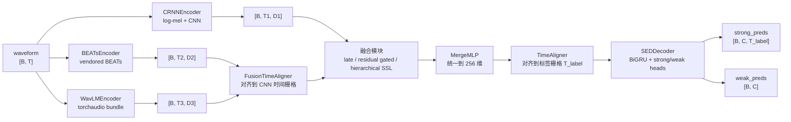
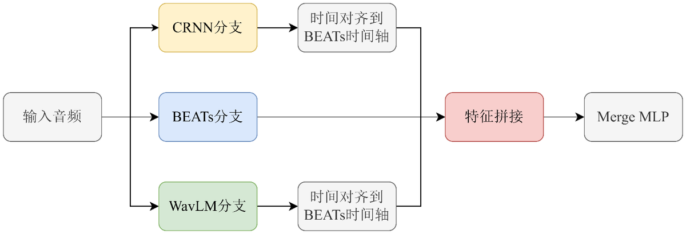
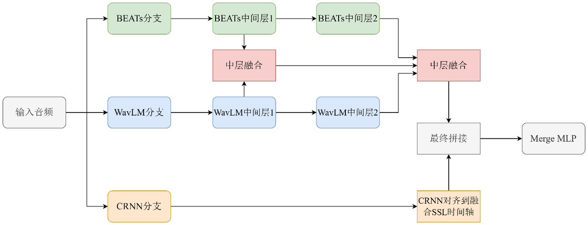
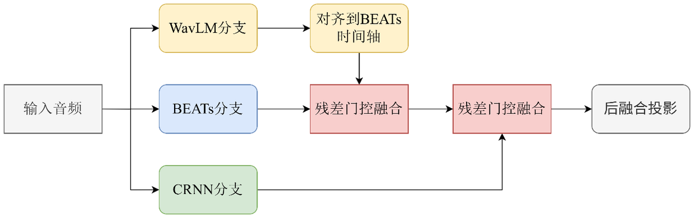

# 体系结构说明

本文说明这个仓库的模型是怎么组装的：一段波形如何经过三个可互换的编码器、如何在时间轴上对齐、如何被融合、如何送入共享解码器输出帧级与片段级预测，以及 Mean-Teacher 训练框架为了支持多分支做了哪些改动。实验数字见 [实验结果](results.md)，环境与数据准备见 [复现说明](reproduction.md)，早期设计阶段的历史记录见 [design/](design/) 目录。

本文的每条结论都对应到仓库里的具体实现，涉及的源文件在文末「代码索引」一节集中列出。

## 1 设计目标

这个仓库的出发点是一个关于"公平比较"的问题。DCASE 2022 Task 4 的官方基线把 Mel 前端、CNN、BiGRU 和强弱标签两个预测头全部写死在一个 CRNN 类里，想换掉前端表征就必须同时改训练流程、特征尺度和损失计算，任何一次替换都会把"表征差异"和"实现差异"混在一起。因此重构的第一个目标是把编码器从训练流程里剥出来：只要新编码器满足「波形进、序列特征出」这一条接口，训练、对齐、解码、后处理就全部复用。

第二个目标是让融合方式成为配置而不是新代码。三种分支组合（单分支、双分支、三分支）和三条融合路由（late、residual gated、hierarchical SSL）都通过 YAML 里的 `model.fusion.strategy` 与 `model.branches.*.enabled` 表达，`build_sed_model()` 负责把配置翻译成一个具体的模型对象。

第三个目标是保留可分析的中间量。多分支模型除了输出预测，还通过 forward 返回的字典暴露每一路的原始特征、对齐后特征、投影后特征、门控权重等十几个键，这样后续做表征分析、可视化与失败诊断时不需要改模型代码。

## 2 数据流

单编码器路径（只有一个分支启用时）最短：波形进入编码器得到 `[B, T_enc, D]` 的序列特征，经过 `TimeAligner` 对齐到标签栅格 `T_label`，再送入共享解码器得到 strong 与 weak 两个预测。

多分支路径在编码器和解码器之间插入融合层，并且有两次对齐：一次发生在融合之前（把 SSL 分支的时间轴对齐到 CNN 的时间栅格），一次发生在融合之后（把融合表示对齐到标签栅格）。

## 3 三个编码器

三个编码器对外暴露的契约完全一致：`forward(audio, padding_mask=None)` 返回一个字典，其中 `sequence_features` 的形状为 `[B, T, D]`，`frontend_features` 只在 CRNN 分支上存在（用于可视化 log-mel 输入）。`output_dim` 在构造时静态确定，融合模块据此决定投影层维度。

| 编码器 | 输入 | 前端 | 输出维度 | 关键参数 |
|---|---|---|---|---|
| `CRNNEncoder` | 波形 `[B, T]` | `MelSpectrogram` + `AmplitudeToDB` + 实例归一化 scaler + `CNN` | `最后一层通道数 × 剩余频率维` | `n_mels=128`、`hop_length=256`、`n_window=2048`、`pooling=[[2,2],[2,2],[1,2]×5]` |
| `BEATsEncoder` | 波形 `[B, T]` | vendored BEATs（`BEATsConfig` + `BEATs`） | `encoder_embed_dim`（768） | `freeze`、`feature_layer`、`selected_layers`、`fbank_mean/std` |
| `WavLMEncoder` | 波形 `[B, T]` | `torchaudio` WavLM bundle | `encoder_embed_dim`（768） | `bundle_name`、`freeze`、`output_layer`、`normalize_waveform` |

`CRNNEncoder` 基本沿用上游 CRNN 的前端：Mel 频谱经过 `AmplitudeToDB` 后裁剪到 `[-50, 80]` 区间，再由训练器注入的 `input_scaler` 做实例级 min-max 归一化，然后进入七层 CNN。卷积后如果频率维还没有压到 1，会把频率维折叠进特征维并给出一次 warning，这是为了在自定义 pooling 配置下仍能输出 `[B, T, D]` 而做的兜底。`train_cnn=False` 时整个 CNN 冻结，`freeze_bn=True` 时所有 BatchNorm 强制切到 eval 且不更新仿射参数。

`BEATsEncoder` 使用仓库内 vendored 的最小官方实现（`sed_modeling/third_party/beats/`），只保留特征提取所需代码，从而避开 fairseq / hydra 这类重依赖。它有两种工作模式：`freeze=True` 时冻结全部参数并在 `no_grad` 下前向，作为特征提取器；`freeze=False` 时随主模型一起微调。编码器内部会按 BEATs 官方的 fbank 均值方差（`15.41663` / `6.55582`）做归一化，并在需要时取第 `feature_layer` 层的输出；为了支持层级融合，它还允许通过 `selected_layers` 一次返回多层 hidden states。BEATs 前向过程默认关闭 autocast，避免半精度下 Transformer 前向与官方实现产生数值差异。

`WavLMEncoder` 基于 `torchaudio.pipelines` 的 WavLM bundle 构建模型，支持两种权重来源：直接使用 bundle 自带权重（`use_bundle_weights=True`），或从自定义 checkpoint 加载。后者需要处理官方权重与 torchaudio 模型之间的前缀差异，代码里的 `_strip_prefixes` 会递归剥掉 `model.` / `state_dict.` / `module.` / `wavlm.` / `encoder.` 这几类前缀，`_extract_state_dict` 兼容 `model`、`state_dict` 与裸 state dict 三种容器形式。前向时把 `[B, T]` 的 padding mask 转换成 torchaudio 需要的 `lengths`，`normalize_waveform=True` 时会先对波形做 layer norm。

## 4 时间对齐

时间对齐是这个框架里最容易被低估、但直接决定比较是否公平的模块。

三路编码器的时间步来源完全不同：CRNN 的 `T` 来自卷积下采样（`hop_length=256` 对应 16 ms 一帧，CNN 在时间维再下采样 4 倍，因此输出约 64 ms 一帧），BEATs 的 `T` 来自 patch embedding 与 Transformer 的序列长度，WavLM 的 `T` 来自卷积特征提取器与 Transformer 的下采样。而损失函数、后处理与 PSDS 评估都工作在固定的标签帧栅格 `T_label` 上。如果不显式对齐，每一处使用这些特征的地方都要各自写 resize，比较结果就无法归因。

`TimeAligner` 因此被做成一个显式模块，输入必须是 `[B, T, D]`，输出 `[B, target_length, D]`，支持四种策略：

| method | 实现 | 适用场景 |
|---|---|---|
| `interpolate` | `F.interpolate`（默认 `linear`，`align_corners=False`） | 默认策略，长度差异不大时保留时序变化趋势 |
| `nearest` | `F.interpolate(mode="nearest")` | 需要保持原始离散帧取值时 |
| `adaptive_avg` | `F.adaptive_avg_pool1d` | 把较长序列压缩到目标长度，避免直接截断丢信息 |
| `adaptive_max` | `F.adaptive_max_pool1d` | 关注短时强响应（如瞬态事件）时 |

`FusionTimeAligner` 继承自 `TimeAligner`，但接口换成"对齐到另一路序列"：`forward(sequence, reference)` 以 `reference.shape[1]` 作为目标长度。双分支与三分支的 late 融合都用它把 SSL 分支对齐到 CNN 分支的时间栅格，之后再拼接或门控。这两次对齐的职责被刻意分开：融合前的对齐保证"同一时间位置的异构特征可以逐元素比较"，融合后的对齐保证"输出与标签栅格对齐"。

## 5 融合

### 5.1 late 融合：拼接与整合

late 融合先把各路特征对齐到同一时间栅格，再沿特征维拼接（`fusion_type: concat`）或直接相加（`fusion_type: add`），然后交给 `MergeMLP` 把维度映射到后续解码器可接收的统一空间。`MergeMLP` 是一个"Linear → 激活 → Dropout（→ 可选 LayerNorm）"的轻量映射层，输出维度由 `merge_mlp_dim`（默认 256）决定；它不承担筛选信息的职责，只负责把拼接后膨胀的特征压回可控维度，并把不同分支的特征混合到同一个表示空间。

论文中与"特征拼接"并列的"固定式中层融合"在代码里没有独立的模型类，它落在同一条 late 路由上，通过融合位置与 MergeMLP 的配置差异表达；三种三分支融合方式的具体配置组合记录在论文实验日志中，仓库保留的是这条路由的全部可调项（见 [design/fusion-late.md](design/fusion-late.md)）。

### 5.2 残差门控融合

残差门控是这篇工作里最核心的设计。它不把两路特征对称地拼在一起，而是明确指定 BEATs 为主路径、CRNN 为修正分支，让新增信息以门控残差的形式叠加：

$$
\text{fused} = \text{beats\_norm} + \alpha \cdot \text{gate} \cdot \text{cnn\_norm}
$$

其中 `gate = sigmoid(gate_net([cnn_norm, beats_norm]))`。为了让两条来自不同表征空间的支路可比，两路特征先各自经过独立线性投影（`cnn_proj` / `beats_proj`）与分支 LayerNorm（`cnn_norm` / `beats_norm`），再拼接送入门控网络。门控网络的最后一层偏置初始化为 `-1.5`，于是训练初期 gate ≈ 0.18，模型基本等价于强分支本身，只有训练证明修正有效时门控才会打开；`use_alpha_scale=True` 时 α 也是可学习参数，否则是一个固定 buffer。门控有两种粒度：`gate_mode: channel` 输出与特征维同长的通道级权重，`gate_mode: frame` 只输出一个标量、由广播作用在时间维上。融合后的特征还可以经过一次 `post_fusion_proj`（Linear + LayerNorm + Dropout）再送进解码器。

参数集中在 `model.fusion.residual_gated` 下：`fuse_dim` 控制投影维度，`gate_hidden_dim` 控制门控网络隐层，`gate_activation` 支持 relu / gelu，`gate_dropout` 作用于门控网络，`use_post_fusion_proj` 与 `post_fusion_dim` 控制融合后投影。三分支版本把这个模块用两次：先以 CRNN+BEATs 的融合表示为主路径，再把 WavLM 作为第二个残差支路接入，从而保证新增分支始终只能"修正"而不能"重置"已有强表示。

### 5.3 hierarchical SSL 融合（论文之后的扩展）

论文完成之后，仓库继续尝试了一种层级融合：不再只取 BEATs 与 WavLM 的最后一层，而是同时取多个中间层（例如 `beats_layers: [5, 11]`、`wavlm_layers: [5, 11]`），以 BEATs 的时间轴为锚点逐层对齐后再做门控融合，并且可以选择对门控输入做 stop-gradient，避免弱分支的梯度反过来扰动强分支的中间表示。这部分对应 `strategy: hierarchical_ssl` 与 `model.ssl_hierarchical_fusion` 配置段，单元测试见 `tests/test_hierarchical_ssl_fusion.py`。它没有被纳入论文的对比表，属于后续工作，README 与 results 中不引用它的数字。

## 6 解码器与预测头

所有路由共用一个 `SEDDecoder`。它由四部分组成：可选的输入投影（`input_proj_dim`，与输入维度一致时退化为 `Identity`）、可选的时序模块（默认两层 BiGRU，`hidden_dim=128`，来自上游 `desed_task.nnet.RNN.BidirectionalGRU`）、Dropout、以及两个预测头。

帧级头是一个 `Linear(head_dim → n_classes)`，输出经 sigmoid 得到 `strong_preds`，形状先把时间与类别维度转置成 `[B, C, T]`。片段级头有两种实现：`attention=True` 时用 `attention_head` 在时间维上算注意力权重（softmax 后做数值裁剪），再对 strong 概率加权平均得到 `weak_preds`，等价于注意力池化；`attention=False` 时直接对时间维取均值。解码器同时返回 `strong_logits`、`decoder_inputs`、`frame_features` 与 `attention_weights`，供训练时的损失计算和后续分析使用。

## 7 模型装配：`build_sed_model` 路由

`resolve_model_config()` 先把 YAML 展开成一份完整的模型配置：它从 `net` 段推导 CRNN 编码器与解码器的默认参数，再叠加 `model` 段，最后根据启用的分支组合与融合策略决定 `model_type`。`build_sed_model()` 则根据 `model_type` 构造对应的模型对象：

| 启用分支 | 融合策略 | `model_type` | 模型类 |
|---|---|---|---|
| 任一单分支 | — | `single_encoder` | `SEDModel` |
| CRNN + BEATs | late | `crnn_beats_late_fusion` | `CRNNBEATsLateFusionModel` |
| CRNN + WavLM | late | `crnn_wavlm_late_fusion` | `CRNNWavLMLateFusionModel` |
| CRNN + BEATs + WavLM | late | `crnn_beats_wavlm_late_fusion` | `CRNNBEATsWavLMLateFusionModel` |
| CRNN + BEATs | residual_gated | `crnn_beats_residual_gated_fusion` | `CRNNBEATsResidualGatedFusionModel` |
| CRNN + WavLM | residual_gated | `crnn_wavlm_residual_gated_fusion` | `CRNNWavLMResidualGatedFusionModel` |
| CRNN + BEATs + WavLM | residual_gated | `crnn_beats_wavlm_residual_gated_fusion` | `CRNNBEATsWavLMResidualGatedFusionModel` |
| CRNN + BEATs + WavLM | hierarchical_ssl | `crnn_beats_wavlm_hierarchical_ssl_fusion` | `CRNNBEATsWavLMHierarchicalSSLFusionModel` |

这些模型类是"薄包装"：它们只负责按固定数据流调用编码器、融合对齐器、融合模块、标签对齐器与解码器，并把中间特征打包进输出字典；真正的计算都在 `encoders/`、`modules/` 与 `decoders/` 里。这样做的结果是，新增一种分支组合只需要写一个几十行的编排类，而不必复制训练逻辑。`residual_gated` 路由还会强制设置主分支：CRNN+BEATs 组合以 BEATs 为主，CRNN+WavLM 组合以 WavLM 为主，三分支组合以 BEATs 为主，并在配置里把 `fusion_type` 记为 `residual_gated` 或 `beats_main_residual_gated`。

此外，`SEDModel` 与各融合模型都实现了 `make_teacher_copy()`，用于 Mean-Teacher 的教师模型初始化；当编码器处于冻结状态且配置允许时，教师直接共享学生同一份冻结编码器，避免在显存里存两份大模型。

## 8 训练框架与多分支适配

训练入口是 `train_sed.py`，训练器是 `local/sed_trainer.py` 中的 `SEDTask4`，沿用上游 DCASE baseline 的 Mean-Teacher 半监督框架。教师模型是学生参数的指数移动平均（`ema_factor=0.999`），每个优化步后更新；学生模型同时接收两类信号：有标签数据的监督损失（强标签帧级 BCE、弱标签片段级 BCE）与无标签数据上的一致性损失（默认 MSE，由 `training.self_sup_loss` 选择），一致性损失的权重是 `const_max` 乘以学习率调度器的缩放因子，随训练进程逐步上升。

为多分支结构做的改动主要有五处。第一，`build_sed_model()` 统一了模型构造，训练器不再直接实例化 CRNN，而是接收一个满足统一接口的模型对象。第二，优化器按模块分组：`opt.param_groups.enable` 打开时，编码器、融合模块与解码器可以各自使用不同的学习率（例如 BEATs `lr_beats`、WavLM `lr_wavlm`、融合 `lr_fusion`、解码器 `lr_decoder`），且只收集 `requires_grad=True` 的参数，冻结分支不会进入优化器。第三，mixup 从特征空间移到了 waveform 空间：保证不同编码器看到的是同一份增强音频，否则不同分支看到的"同一批样本"其实并不同。第四，teacher 模型支持共享冻结编码器（`model.teacher.share_frozen_*`），在冻结 BEATs / WavLM 时显著降低显存占用。第五，模型在前向时可以返回中间特征字典，训练器与评估脚本据此记录分支利用率、门控统计等信息。

权重加载有三条路径：`--init_from_checkpoint` 只加载权重、不恢复优化器状态（用于 warm start）；`--resume_from_checkpoint` 恢复完整训练状态；`--test_from_checkpoint` / `--eval_from_checkpoint` 只做评估。配置里的 `warmstart` 段（`model.branches.*.warmstart` 与 `model.decoder_warmstart`）会在构建模型时把指定权重加载进对应子模块，支持前缀匹配与 shape 校验，加载不上的键会被打印出来而不是静默忽略。

## 9 配置轴对照表

主配置是 `confs/experiment_unified.yaml`，它同时包含一组 `profiles`，`profile` 字段决定用哪一组参数去覆盖基础配置。下面这些键决定了模型的结构与规模：

| 配置键 | 取值 | 作用 |
|---|---|---|
| `profile` | `server_a800` / `hierarchical_ssl_stage_a` | 选择参数覆盖组；后者把融合切到层级 SSL 路由 |
| `model.branches.crnn.enabled` | true / false | 是否启用 CRNN 分支 |
| `model.branches.beats.enabled` | true / false | 是否启用 BEATs 分支 |
| `model.branches.wavlm.enabled` | true / false | 是否启用 WavLM 分支 |
| `model.branches.crnn.train` | true / false | CRNN 卷积部分是否参与训练 |
| `model.branches.beats.freeze` | true / false | 冻结 BEATs（特征提取）或全量微调 |
| `model.branches.wavlm.freeze` | true / false | 冻结 WavLM 或全量微调 |
| `model.branches.*.warmstart.enable` | true / false | 是否从指定 checkpoint 加载该分支权重 |
| `model.fusion.strategy` | `late` / `residual_gated` / `hierarchical_ssl` | 选择融合路由 |
| `model.fusion.fusion_type` | `concat` / `add` / `residual_gated` / `beats_main_residual_gated` / `hierarchical_ssl` | 路由内的具体融合形式 |
| `model.fusion.main_branch` | `auto` / `beats` / `wavlm` | 残差门控的主路径选择 |
| `model.fusion.late.merge_mlp_dim` | 整数，默认 256 | MergeMLP 输出维度 |
| `model.fusion.residual_gated.fuse_dim` | 整数，默认 256 | 门控融合的投影维度 |
| `model.fusion.residual_gated.gate_mode` | `channel` / `frame` | 门控粒度 |
| `model.fusion.residual_gated.gate_hidden_dim` | 整数或 null | 门控网络隐层维度（null 时等于 `fuse_dim`） |
| `model.fusion.residual_gated.alpha_init` | 浮点，默认 0.2 | α 的初值（门控偏置 −1.5 是模块默认值，不通过 YAML 配置） |
| `model.fusion.residual_gated.use_alpha_scale` | true / false | α 是否可学习 |
| `model.fusion.residual_gated.use_post_fusion_proj` | true / false | 融合后是否再做一次投影 |
| `model.align.method` | `interpolate` / `nearest` / `adaptive_avg` / `adaptive_max` | 标签栅格对齐策略 |
| `model.fusion.*.align_method` | 同上 | 融合前的分支间对齐策略 |
| `model.decoder.use_gru` / `hidden_dim` / `rnn_layers` | bool / 128 / 2 | 解码器时序模块配置 |
| `model.decoder.attention` | true / false | weak 头是否使用注意力池化 |
| `model.teacher.share_frozen_encoder` 等 | true / false | 教师是否共享冻结编码器 |
| `training.synth_only` | true / false | 只用合成强标签数据训练 |
| `training.mixup` | `soft` / `hard` / null | 波形域 mixup 类型 |
| `training.self_sup_loss` | `mse` / `bce` | 一致性损失形式 |
| `opt.param_groups.enable` | true / false | 是否启用分组学习率 |

## 10 与论文的差异、以及已知限制

**论文的三种三分支融合方式与代码不是一一对应的类。** 代码提供的是 late、residual_gated、hierarchical_ssl 三条路由以及路由内的配置项；论文表 6 中"特征拼接""固定式中层融合""残差门控融合"三行的具体配置组合记录在当时的实验服务器上（`exp/` 目录未随仓库发布）。阅读代码时应当以本文的路由描述为准，论文表格的数值见 [results.md](results.md)。

**半监督数据管线保留，但当前配置是 `synth_only`。** 训练器仍然支持弱标签、无标签与真实强标签数据，`--strong_real` 与 `training.synth_only` 可以切换；论文实验使用的是合成强标签训练集与合成验证集。

**层级 SSL 融合是论文之后的扩展。** 它带单元测试、能跑通，但没有进入论文的对比表，因此 README 与结果文档都不引用它的数字。

**部分历史命名保留。** 例如 `fusion_type: beats_main_residual_gated` 与模块类名 `BeatsMainResidualGatedFusion` 保留了论文阶段的叫法，配置键与代码类名之间不是完全一一对应；修改时以 `resolve_model_config()` 的映射逻辑为准。

**训练流程未在干净环境端到端验证。** 代码逻辑、配置与文档是一致的，但依赖版本组合、数据目录与权重文件需要使用者自行准备，详见 [reproduction.md](reproduction.md)。

## 11 代码索引

| 文件 | 职责 |
|---|---|
| `train_sed.py` | 训练 / 评估入口，参数解析、profile 解析、优化器分组、checkpoint 加载 |
| `sed_modeling/models/sed_model.py` | 配置解析、路由决策、`build_sed_model`、单编码器模型、各分支 warm-start 加载 |
| `sed_modeling/models/crnn_*_fusion.py` | 七种融合模型的编排类（6 个双/三分支 + 1 个层级 SSL） |
| `sed_modeling/encoders/crnn_encoder.py` | log-mel 前端 + CNN 编码器 |
| `sed_modeling/encoders/beats_encoder.py` | BEATs 编码器，含单层 / 多层特征提取与分支权重加载 |
| `sed_modeling/encoders/wavlm_encoder.py` | WavLM 编码器，含 bundle 解析、checkpoint 前缀剥离与 padding mask 转换 |
| `sed_modeling/modules/time_aligner.py` | `TimeAligner` 与 `FusionTimeAligner` |
| `sed_modeling/modules/merge_mlp.py` | late 融合后的维度映射层 |
| `sed_modeling/modules/residual_gated_fusion.py` | 双分支残差门控融合块 |
| `sed_modeling/modules/beats_main_residual_gated_fusion.py` | 以 BEATs 为主路径的三分支残差门控块 |
| `sed_modeling/modules/beats_main_hierarchical_wavlm_fusion.py` | 层级 SSL 融合块 |
| `sed_modeling/decoders/sed_decoder.py` | 共享解码器与 strong/weak 双头 |
| `local/sed_trainer.py` | Mean-Teacher 训练器、损失、EMA、后处理与评估 |
| `confs/experiment_unified.yaml` | 统一实验配置与 profile 定义 |
| `tests/` | 层级融合与学习率调度的单元测试 |
