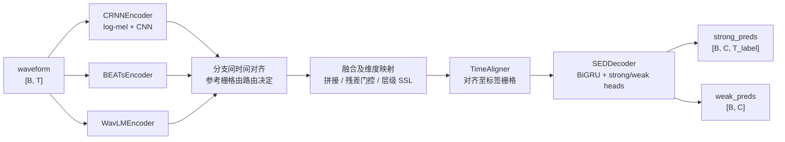

# 体系结构说明

本文说明模型的装配方式，包括三个可互换的编码器、时间对齐、特征融合、共享解码器和 Mean-Teacher 训练框架。实验数字见 [实验结果](results.md)，环境与数据准备见 [复现说明](reproduction.md)，各融合模块的详细说明见 [design/](design/) 目录。

本文的每条结论都对应到仓库里的具体实现，涉及的源文件在文末「代码索引」一节集中列出。

## 1 设计目标

重构的目标是统一异构表征的接入方式。上游 CRNN 类包含 CNN、BiGRU 与强弱预测头，Mel 前端在训练流程中处理。当前框架将波形前端与编码器封装为统一接口，分离对齐、融合与解码，使分支替换能够复用训练、后处理与评估入口。

第二个目标是用配置表达融合方式。三种分支组合（单分支、双分支、三分支）和三条融合路由（late、residual gated、hierarchical SSL）都通过 YAML 里的 `model.fusion.strategy` 与 `model.branches.*.enabled` 表达，`build_sed_model()` 负责把配置翻译成一个具体的模型对象。

第三个目标是保留可分析的中间量。多分支模型除了输出预测，还通过 forward 返回的字典提供各分支的原始特征、对齐后特征、投影后特征和门控权重。这些数据可用于表征分析、可视化和错误诊断。

## 2 数据流

单编码器路径（只有一个分支启用时）最短：波形进入编码器得到 `[B, T_enc, D]` 的序列特征，经过 `TimeAligner` 对齐到标签栅格 `T_label`，再送入共享解码器得到 strong 与 weak 两个预测。

多分支路径在编码器和解码器之间插入融合层。融合参考时间轴由路由决定：late 融合以 CNN 为参考，三分支残差门控可通过 `use_beats_time_anchor` 切换到 BEATs 时间轴；层级 SSL 先在 BEATs 各层时间轴上融合，最后再按配置与 CNN 对齐。融合结果统一对齐至标签栅格。

## 3 三个编码器

三个编码器的 `forward(audio, padding_mask=None)` 均返回字典，`sequence_features` 为 `[B, T, D]`，`output_dim` 在构造时确定。`frontend_features` 在三种编码器中都可返回：CRNN 为归一化频谱，BEATs 为 fbank，WavLM 为输入处理后的波形；它们的形状和语义不同，不能按同一类频谱解释。

| 编码器 | 输入 | 前端 | 输出维度 | 关键参数 |
|---|---|---|---|---|
| `CRNNEncoder` | 波形 `[B, T]` | `MelSpectrogram` + `AmplitudeToDB` + 实例归一化 scaler + `CNN` | `最后一层通道数 × 剩余频率维` | `n_mels=128`、`hop_length=256`、`n_window=2048`、`pooling=[[2,2],[2,2],[1,2]×5]` |
| `BEATsEncoder` | 波形 `[B, T]` | vendored BEATs（`BEATsConfig` + `BEATs`） | `encoder_embed_dim`（768） | `freeze`、`feature_layer`、`selected_layers`、`fbank_mean/std` |
| `WavLMEncoder` | 波形 `[B, T]` | `torchaudio` WavLM bundle | `encoder_embed_dim`（768） | `bundle_name`、`freeze`、`output_layer`、`normalize_waveform` |

`CRNNEncoder` 基本沿用上游 CRNN 的前端：Mel 频谱经过 `AmplitudeToDB` 后裁剪到 `[-50, 80]` 区间，再由训练器注入的 `input_scaler` 做实例级 min-max 归一化，然后进入七层 CNN。卷积后如果频率维还没有压到 1，会把频率维折叠进特征维并给出一次 warning，这是为了在自定义 pooling 配置下仍能输出 `[B, T, D]` 而做的兜底。`train_cnn=False` 时整个 CNN 冻结，`freeze_bn=True` 时所有 BatchNorm 强制切到 eval 且不更新仿射参数。

`BEATsEncoder` 使用仓库内 vendored 的最小官方实现（`sed_modeling/third_party/beats/`），只保留特征提取所需代码，从而避开 fairseq / hydra 这类重依赖。它有两种工作模式：`freeze=True` 时冻结全部参数并在 `no_grad` 下前向，作为特征提取器；`freeze=False` 时随主模型一起微调。编码器内部会按 BEATs 官方的 fbank 均值方差（`15.41663` / `6.55582`）做归一化，并在需要时取第 `feature_layer` 层的输出；为了支持层级融合，它还允许通过 `selected_layers` 一次返回多层 hidden states。冻结模式下，BEATs 前向同时使用 `no_grad` 并关闭 autocast；可训练模式不在编码器内强制关闭 autocast。

`WavLMEncoder` 基于 `torchaudio.pipelines` 的 WavLM bundle 构建模型，支持两种权重来源：直接使用 bundle 自带权重（`use_bundle_weights=True`），或从自定义 checkpoint 加载。自定义 checkpoint 必须与 torchaudio 模型结构相容；前缀处理本身不保证 Microsoft fairseq 格式权重可直接兼容。代码里的 `_strip_prefixes` 会递归剥掉 `model.` / `state_dict.` / `module.` / `wavlm.` / `encoder.` 这几类前缀，`_extract_state_dict` 兼容 `model`、`state_dict` 与裸 state dict 三种容器形式。前向时把 `[B, T]` 的 padding mask 转换成 torchaudio 需要的 `lengths`，`normalize_waveform=True` 时会先对波形做 layer norm。

## 4 时间对齐

时间对齐是这个框架里最容易被低估、但直接决定比较是否公平的模块。

三路编码器的时间步来源完全不同：CRNN 的 `T` 来自卷积下采样（`hop_length=256` 对应 16 ms 一帧，CNN 在时间维再下采样 4 倍，因此输出约 64 ms 一帧），BEATs 的 `T` 来自 patch embedding 与 Transformer 的序列长度，WavLM 的 `T` 来自卷积特征提取器与 Transformer 的下采样。而损失函数、后处理与 PSDS 评估都工作在固定的标签帧栅格 `T_label` 上。如果不显式对齐，每一处使用这些特征的地方都要各自写 resize，比较结果就无法归因。

`TimeAligner` 因此被做成一个显式模块，输入必须是 `[B, T, D]`，输出 `[B, target_length, D]`，支持四种策略：

| method | 实现 | 适用场景 |
|---|---|---|
| `interpolate` | `F.interpolate`（默认 `linear`，`align_corners=False`） | 默认策略，长度差异不大时保留时序变化趋势 |
| `nearest` | `F.interpolate(mode="nearest")` | 需要保持原始离散帧取值时 |
| `adaptive_avg` | `F.adaptive_avg_pool1d` | 把较长序列压缩到目标长度，避免直接截断丢信息 |
| `adaptive_max` | `F.adaptive_max_pool1d` | 关注短时强响应（如瞬态事件）时 |

`FusionTimeAligner` 以 `reference.shape[1]` 为目标长度，对齐至另一路序列。late 融合通常将 SSL 特征对齐至 CNN 时间轴；启用 BEATs 时间锚点的三分支路由则将 WavLM 与 CNN 对齐至 BEATs。融合前的分支间对齐和融合后的标签栅格对齐承担不同职责。

## 5 融合

### 5.1 late 融合：拼接与整合

late 融合先对齐各路特征。双分支支持 `concat` 或 `add`，三分支 late 路由当前仅支持 `concat`。随后使用 `MergeMLP` 映射维度，其实际顺序为“Linear → 可选 LayerNorm → 激活 → Dropout”，输出维度由 `merge_mlp_dim` 控制。相加方式还要求分支维度相容，不能任意替换拼接。

### 5.2 残差门控融合

残差门控在独立投影与 LayerNorm 后融合两路特征。CRNN+BEATs 以 BEATs 为主路径，形式为 `fused = beats_norm + α · gate · cnn_norm`；CRNN+WavLM 以 WavLM 为主路径。通道级门控输出 `[B, T, D]`，帧级门控输出 `[B, T, 1]` 并沿特征维广播。门控网络的末层偏置初始化为 -1.5。`use_alpha_scale=True` 时，α 作为无范围约束的参数参与训练。融合结果可经过 `post_fusion_proj`，再进入标签对齐与解码器。

参数集中在 `model.fusion.residual_gated`。三分支由单个 `BEATsMainResidualGatedFusion` 模块实现：先计算 `fused_ssl = beats_norm + α_wavlm · gate_wavlm · wavlm_norm`，再加入 `α_crnn · gate_crnn · cnn_norm`。默认模式下两路门控均以 BEATs 特征作为主路径输入；启用 BEATs 时间锚点后，CRNN 门控改用归一化的 `fused_ssl` 作为主输入。该路由的 `stopgrad_gate_inputs` 只截断门控控制器输入的梯度，残差特征路径仍正常反向传播。

### 5.3 hierarchical SSL 融合

层级 SSL 融合提取 BEATs 与 WavLM 的多个中间层，例如 `beats_layers: [5, 11]`、`wavlm_layers: [5, 11]`，在每个阶段以 BEATs 时间轴为参考对齐并融合。该模块支持 1 或 2 个阶段，随后将融合后的 SSL 表征与 CNN 特征拼接，经 MergeMLP 和标签对齐进入解码器。对应配置为 `strategy: hierarchical_ssl` 与 `model.ssl_hierarchical_fusion`，装配与形状检查见 `tests/test_hierarchical_ssl_fusion.py`。

## 6 解码器与预测头

所有路由共用一个 `SEDDecoder`。它由四部分组成：可选的输入投影（`input_proj_dim`，与输入维度一致时退化为 `Identity`）、可选的时序模块（默认两层 BiGRU，`hidden_dim=128`，来自上游 `desed_task.nnet.RNN.BidirectionalGRU`）、Dropout、以及两个预测头。

帧级头是一个 `Linear(head_dim → n_classes)`，输出经 sigmoid 得到 `strong_preds`，形状先把时间与类别维度转置成 `[B, C, T]`。片段级头有两种实现：`attention=True` 时用 `attention_head` 在时间维上算注意力权重（softmax 后做数值裁剪），再对 strong 概率加权平均得到 `weak_preds`，等价于注意力池化；`attention=False` 时直接对时间维取均值。解码器同时返回 `strong_logits`、`decoder_inputs`、`frame_features` 与 `attention_weights`，用于损失计算和特征分析。

## 7 模型装配：`build_sed_model` 路由

`resolve_model_config()` 先把 YAML 展开成一份完整的模型配置：它从 `net` 段推导 CRNN 编码器与解码器的默认参数，再叠加 `model` 段，最后根据启用的分支组合与融合策略决定 `model_type`。`build_sed_model()` 则根据 `model_type` 构造对应的模型对象：

| 启用分支 | 融合策略 | `model_type` | 模型类 |
|---|---|---|---|
| 任一单分支 | — | `single_encoder` | `SEDModel` |
| CRNN + BEATs | late | `crnn_beats_late_fusion` | `CRNNBEATsLateFusionModel` |
| CRNN + WavLM | late | `crnn_wavlm_late_fusion` | `CRNNWavLMLateFusionModel` |
| CRNN + BEATs + WavLM | late | `crnn_beats_wavlm_late_fusion` | `CRNNBEATsWavLMLateFusionModel` |
| CRNN + BEATs | residual_gated | `crnn_beats_residual_gated_fusion` | `CRNNBEATsResidualGatedFusionModel` |
| CRNN + WavLM | residual_gated | `crnn_wavlm_residual_gated_fusion` | `CRNNWavLMResidualGatedFusionModel` |
| CRNN + BEATs + WavLM | residual_gated | `crnn_beats_wavlm_residual_gated_fusion` | `CRNNBEATsWavLMResidualGatedFusionModel` |
| CRNN + BEATs + WavLM | hierarchical_ssl | `crnn_beats_wavlm_hierarchical_ssl_fusion` | `CRNNBEATsWavLMHierarchicalSSLFusionModel` |

这些模型类采用轻量封装，只负责按固定数据流调用编码器、融合对齐器、融合模块、标签对齐器与解码器，并把中间特征打包进输出字典。主要计算位于 `encoders/`、`modules/` 与 `decoders/`。新增分支组合时，可以复用训练逻辑并添加对应的编排类。`residual_gated` 路由会设置主分支：CRNN+BEATs 组合以 BEATs 为主，CRNN+WavLM 组合以 WavLM 为主，三分支组合以 BEATs 为主，并在配置里把 `fusion_type` 记为 `residual_gated` 或 `beats_main_residual_gated`。

此外，`SEDModel` 与各融合模型都实现了 `make_teacher_copy()`，用于 Mean-Teacher 的教师模型初始化；当编码器处于冻结状态且配置允许时，教师直接共享学生同一份冻结编码器，避免在显存里存两份大模型。

## 8 训练框架与多分支适配

训练入口为 `train_sed.py`，训练器为 `local/sed_trainer.py` 中的 `SEDTask4`。Mean-Teacher 教师参数按 EMA 更新。监督损失按强、弱标签掩码计算；一致性损失对整批学生与教师预测计算，在 `synth_only` 下覆盖合成强标签样本。损失形式由 `training.self_sup_loss` 选择，权重为 `const_max` 乘以调度器缩放因子。

多分支训练框架包含五项功能。第一，`build_sed_model()` 根据统一接口构造模型，训练器接收构造完成的模型对象。第二，`opt.param_groups.enable` 打开时，编码器、融合模块与解码器可以分别使用学习率，例如 BEATs 使用 `lr_beats`、WavLM 使用 `lr_wavlm`、融合模块使用 `lr_fusion`、解码器使用 `lr_decoder`。优化器仅收集 `requires_grad=True` 的参数。第三，mixup 在 waveform 空间执行，使不同编码器接收同一份增强音频。第四，teacher 模型支持共享冻结编码器（`model.teacher.share_frozen_*`），从而降低 BEATs 和 WavLM 冻结时的显存占用。第五，模型前向可以返回中间特征字典，训练器与评估脚本使用该字典统计分支利用率和门控值。

权重加载有三条路径：`--init_from_checkpoint` 加载模型参数并创建新的优化器状态；`--resume_from_checkpoint` 恢复完整训练状态；`--test_from_checkpoint` 和 `--eval_from_checkpoint` 进入评估流程。配置里的 `warmstart` 段（`model.branches.*.warmstart` 与 `model.decoder_warmstart`）会在构建模型时把指定权重加载进对应子模块，支持前缀匹配与 shape 校验。加载失败的键会输出到日志。

## 9 配置轴对照表

主配置是 `confs/experiment_unified.yaml`，它同时包含一组 `profiles`，`profile` 字段决定用哪一组参数去覆盖基础配置。下面这些键决定了模型的结构与规模：

| 配置键 | 取值 | 作用 |
|---|---|---|
| `profile` | `rtx_5090` / `hierarchical_ssl_stage_a` | 选择参数覆盖组；前者提供单卡训练参数覆盖（残差门控三分支），后者把融合切到层级 SSL 路由 |
| `model.branches.crnn.enabled` | true / false | 是否启用 CRNN 分支 |
| `model.branches.beats.enabled` | true / false | 是否启用 BEATs 分支 |
| `model.branches.wavlm.enabled` | true / false | 是否启用 WavLM 分支 |
| `model.branches.crnn.train` | true / false | CRNN 卷积部分是否参与训练 |
| `model.branches.beats.freeze` | true / false | 冻结 BEATs（特征提取）或全量微调 |
| `model.branches.wavlm.freeze` | true / false | 冻结 WavLM 或全量微调 |
| `model.branches.*.warmstart.enable` | true / false | 是否从指定 checkpoint 加载该分支权重 |
| `model.fusion.strategy` | `late` / `residual_gated` / `hierarchical_ssl` | 选择融合路由 |
| `model.fusion.fusion_type` | `concat` / `add` / `residual_gated` / `beats_main_residual_gated` / `hierarchical_ssl` | 路由内的具体融合形式 |
| `model.fusion.main_branch` | `auto` / `beats` / `wavlm` | 残差门控的主路径选择 |
| `model.fusion.late.merge_mlp_dim` | 整数，默认 256 | MergeMLP 输出维度 |
| `model.fusion.residual_gated.fuse_dim` | 整数，默认 256 | 门控融合的投影维度 |
| `model.fusion.residual_gated.gate_mode` | `channel` / `frame` | 门控粒度 |
| `model.fusion.residual_gated.gate_hidden_dim` | 整数或 null | 门控网络隐层维度（null 时等于 `fuse_dim`） |
| `model.fusion.residual_gated.alpha_init` | 浮点，默认 0.2 | α 的初值（门控偏置 −1.5 是模块默认值，不通过 YAML 配置） |
| `model.fusion.residual_gated.use_alpha_scale` | true / false | α 是否可学习 |
| `model.fusion.residual_gated.use_post_fusion_proj` | true / false | 融合后是否再做一次投影 |
| `model.align.method` | `interpolate` / `nearest` / `adaptive_avg` / `adaptive_max` | 标签栅格对齐策略 |
| `model.fusion.*.align_method` | 同上 | 融合前的分支间对齐策略 |
| `model.decoder.use_gru` / `hidden_dim` / `rnn_layers` | bool / 128 / 2 | 解码器时序模块配置 |
| `model.decoder.attention` | true / false | weak 头是否使用注意力池化 |
| `model.teacher.share_frozen_encoder` 等 | true / false | 教师是否共享冻结编码器 |
| `training.synth_only` | true / false | 只用合成强标签数据训练 |
| `training.mixup` | `soft` / `hard` / null | 波形域 mixup 类型 |
| `training.self_sup_loss` | `mse` / `bce` | 一致性损失形式 |
| `opt.param_groups.enable` | true / false | 是否启用分组学习率 |

## 10 实现范围

代码提供 `late`、`residual_gated` 和 `hierarchical_ssl` 三条融合路由。训练器支持合成强标签、真实强标签、弱标签和无标签数据。实验结果使用 `synth_only` 配置，对应合成强标签训练集与合成验证集。

配置键 `fusion_type: beats_main_residual_gated` 对应 `BEATsMainResidualGatedFusion`。完整映射由 `resolve_model_config()` 处理。训练依赖、数据目录和权重文件的准备方式见 [reproduction.md](reproduction.md)。

## 11 代码索引

| 文件 | 职责 |
|---|---|
| `train_sed.py` | 训练 / 评估入口，参数解析、profile 解析、优化器分组、checkpoint 加载 |
| `sed_modeling/models/sed_model.py` | 配置解析、路由决策、`build_sed_model`、单编码器模型、各分支 warm-start 加载 |
| `sed_modeling/models/crnn_*_fusion.py` | 七种融合模型的编排类（6 个双/三分支 + 1 个层级 SSL） |
| `sed_modeling/encoders/crnn_encoder.py` | log-mel 前端 + CNN 编码器 |
| `sed_modeling/encoders/beats_encoder.py` | BEATs 编码器，含单层 / 多层特征提取与分支权重加载 |
| `sed_modeling/encoders/wavlm_encoder.py` | WavLM 编码器，含 bundle 解析、checkpoint 前缀剥离与 padding mask 转换 |
| `sed_modeling/modules/time_aligner.py` | `TimeAligner` 与 `FusionTimeAligner` |
| `sed_modeling/modules/merge_mlp.py` | late 融合后的维度映射层 |
| `sed_modeling/modules/residual_gated_fusion.py` | 双分支残差门控融合块 |
| `sed_modeling/modules/beats_main_residual_gated_fusion.py` | 以 BEATs 为主路径的三分支残差门控块 |
| `sed_modeling/modules/beats_main_hierarchical_wavlm_fusion.py` | 层级 SSL 融合块 |
| `sed_modeling/decoders/sed_decoder.py` | 共享解码器与 strong/weak 双头 |
| `local/sed_trainer.py` | Mean-Teacher 训练器、损失、EMA、后处理与评估 |
| `confs/experiment_unified.yaml` | 统一实验配置与 profile 定义 |
| `tests/` | 层级融合与学习率调度的单元测试 |
