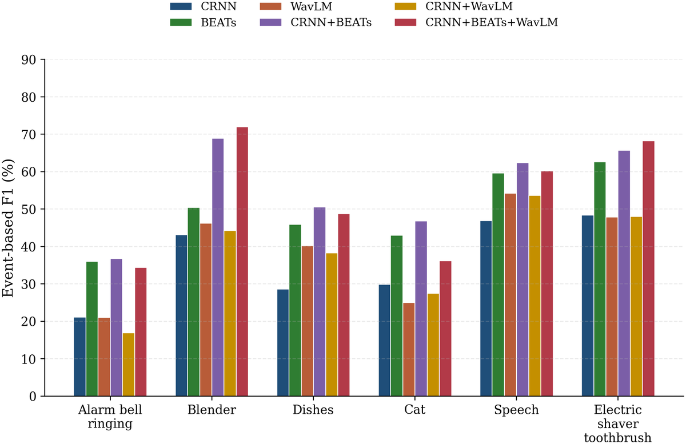
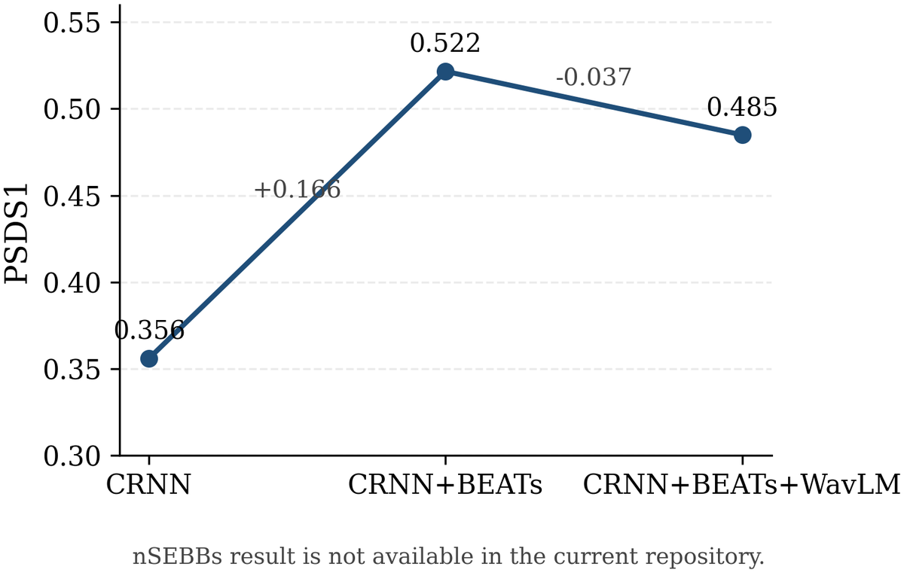
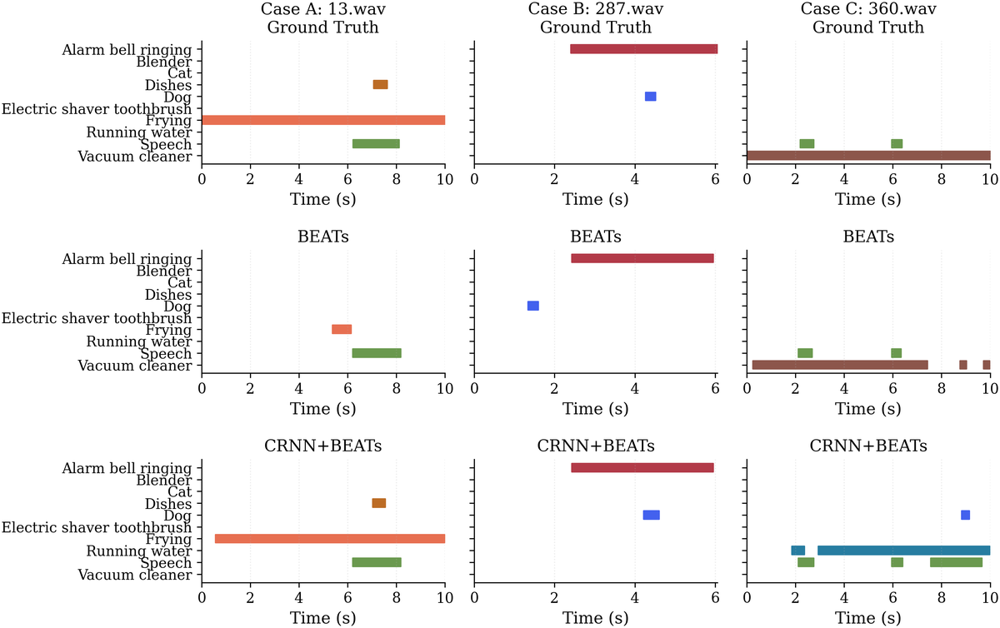

# DESED 声音事件检测实验结果

本文档汇总本项目在 DCASE 2022 Task 4 / DESED 数据集上的实验结果与分析结论，是仓库中实验数字的唯一权威说明，也是根目录 README 结果部分的直接来源。文档中的定量结果全部取自论文《异构自监督模型互补融合的声音事件检测研究》第 4 章的表 4、表 5 和表 6，表 2、表 3 的原始数据同样引自该章；为便于与论文对照，本文表格编号沿用论文编号（表 2 至表 6），图号则按本文出现顺序编排。方法结构、编码器接口与融合实现的细节见 `docs/architecture.md`，环境与数据准备见 `docs/reproduction.md`，本文只讨论“实验怎么设、结果是什么、这些结果应当怎么读”。

文档按以下顺序展开：首先说明实验设定与评价指标，然后依次给出基准模型对比（表 4）、类别级分析（表 5）、融合方式对比（表 6），在此基础上讨论几个关键观察，尤其是负结果应当如何表述，接着用一个典型样本的时间轴案例说明指标差异在具体音频上的表现，最后给出结论、局限以及与仓库存档数据之间的口径关系。

## 1 实验设定

实验在 DCASE 2022 Task 4 的 DESED 数据集上开展。该数据集面向日常室内环境中的声音事件检测，共包含十类典型事件：AB（Alarm bell ringing，闹钟/铃声）、BLE（Blender，搅拌机）、CAT（Cat，猫叫）、DIS（Dishes，杯碟碰撞）、DOG（Dog，狗叫）、ES（Electric shaver/toothbrush，电动剃须刀/牙刷）、FRY（Frying，煎炸声）、RW（Running water，流水声）、SPE（Speech，语音）和 VC（Vacuum cleaner，吸尘器）。本文所有实验均采用强标签训练设定，即训练只用带精确起止时间标注的合成数据，评估在同样带强标签的合成验证集上进行；对应到仓库配置，就是 `synth_only` 设定下 synthetic train 加 synthetic validation 的组合。训练阶段没有混入 real 强标签、弱标签或无标签数据，因此本文比较的是“同一训练范式、同一数据条件下，不同特征来源与融合结构”的差异，而不是半监督数据利用方式带来的差异。

训练框架沿用均值教师（Mean-Teacher）半监督框架，学生模型接收监督损失与一致性约束，教师模型由学生参数的指数移动平均得到；保留这套框架的目的是让单分支、双分支和三分支结构在完全相同的训练流程、损失构成和后处理条件下比较，使结构差异成为唯一变量。训练与评估共用一份统一配置，解码器、后处理流程与 PSDS 的多阈值扫描方式在各结构之间保持一致，因此表 4 至表 6 中的模型可以直接横向比较。

实验使用单张 RTX 5090（32GB 显存）完成，随机种子固定为 42，每种结构只训练、评估一次，没有做多种子重复或交叉验证。这一点在解读百分点级的差异时非常重要，本文的结论只声称“在该设定下成立”，不声称统计显著性。软硬件配置如表 2 所示。

参与比较的模型可以分成三类：三种单分支结构（CRNN、BEATs、WavLM）用于判断不同特征来源单独使用时的上限；两种双分支结构（CRNN+BEATs、CRNN+WavLM）用于确认“哪两类表征互补”；一种三分支结构（CRNN+BEATs+WavLM，包含特征拼接、固定式中层融合、残差门控融合三种变体）用于检验新增语音域表征能否在强参考之上提供额外信息。三类模型共用同一套数据划分、解码器与后处理，因此表 4、表 5、表 6 之间的横向比较不会因训练或评估流程不同而失真。

表 2：实验配置（对应论文表 2）

| 类别 | 配置项 | 具体参数 |
|---|---|---|
| 软件平台 | 操作系统 | Ubuntu 20.04 |
| 软件平台 | Python 版本 | 3.10.20 |
| 软件平台 | PyTorch 版本 | 2.7.1+cu128 |
| 软件平台 | CUDA 版本 | 13.0 |
| 硬件平台 | CPU | Intel(R) Xeon(R) Platinum 8470Q |
| 硬件平台 | 内存容量 | 90GB |
| 硬件平台 | GPU | RTX 5090 |
| 硬件平台 | 显存大小 | 32GB |

表 3 给出了 DESED 各类事件在强标注训练数据中的分布概况。这张表对后文的类别级分析很关键：SPE 的事件数占总强标签事件的 30.3%，是样本最多的类别；DIS 的事件数少、平均时长只有 0.61 秒，属于典型的短事件；AB、ES、FRY、VC、RW 的平均时长则接近或超过 7 秒，属于持续性事件。类别之间在样本量、持续时间和边界清晰度上的差异，直接决定了同一个模型在不同类别上的 Event-F1 会相差几十个百分点，因此表 5 的类别级比较不能只看宏平均。

表 3：DESED 数据集事件类别及强标注训练数据分布概况（对应论文表 3）

| 类别 | 事件数 | 总时长（秒） | 平均时长（秒） | 占总强标签比例 |
|---|---|---|---|---|
| AB | 1641 | 12747.0 | 7.77 | 12.8% |
| BLE | 704 | 6484.7 | 9.21 | 6.5% |
| CAT | 998 | 4792.5 | 4.80 | 4.8% |
| DIS | 2563 | 1567.9 | 0.61 | 1.6% |
| DOG | 1418 | 6238.5 | 4.40 | 6.2% |
| ES | 529 | 5483.0 | 10.36 | 5.5% |
| FRY | 986 | 8396.6 | 8.52 | 8.4% |
| RW | 1277 | 12111.9 | 9.48 | 12.1% |
| SPE | 4879 | 30283.6 | 6.21 | 30.3% |
| VC | 792 | 7693.4 | 9.71 | 7.7% |
| 合计 | 15787 | 95799.1 | 6.07 | 100% |

需要说明的是，以上是 DESED 开发集的整体统计，用来描述类别不均衡与时长分布；本文实验的训练集是其中的合成强标签部分，评估集是合成验证集，具体的目录与文件准备方式见 `docs/reproduction.md`。此外，本文没有向 DCASE 官方测试集提交结果，所有数字都是本地合成验证集上的评估值，这一点在第 8 节会作为局限再次说明。

## 2 评价指标

声音事件检测需要同时完成“识别事件类别”和“确定起止时间”两件事，任何单一指标都只能覆盖其中一面，因此本文采用 PSDS、Event-F1 和 Inter-F1 三类指标从不同层面评价模型。F1 本身是精确率与召回率的调和平均，具体到 SED 任务，“一次预测是否算命中”取决于该指标对类别、时间区间和重叠程度的要求，三类指标的区别正来自这里。

Event-F1 评价的是完整事件的检出能力。它要求预测事件的类别正确，并且预测的起点和终点与真实事件的起点和终点之间的偏差落在允许范围内，才把这次预测算作命中。也就是说，Event-F1 关心的是模型有没有把一个完整事件从头到尾地识别出来，对事件的碎片化、合并与边界偏移都比较敏感。

Inter-F1 则更关注预测区间与真实区间在时间轴上的重合程度，它按预测事件和真实事件在时间轴上的交集关系进行匹配，衡量的是模型对事件持续时间和边界覆盖的刻画能力。一个模型如果预测得“多而长”，把真实事件大部分覆盖住，Inter-F1 通常不会差，但它可能同时产生大量碎片化预测，在 Event-F1 上被逐条惩罚。正因为两者关注点不同，Event-F1 与 Inter-F1 的走势可以出现分化，本文三分支结构的行为就集中体现在这种分化上。

PSDS（Polyphonic Sound Detection Score）与上述两个指标最根本的区别在于它不是单一检测阈值下的结果。PSDS 在预设的有效误报率范围内统计检测性能曲线，并对曲线下面积做归一化，反映模型在多个阈值、多个工作点上的综合表现；PSDS1 和 PSDS2 对应两种不同的评估场景与容忍度设置，数值越高说明模型在不同误报水平下保持检测性能的能力越强。图 1 是 PSDS 的曲线面积示意图，模型 A 的曲线整体高于模型 B，因此其曲线下面积更大、PSDS 更高。

把三类指标放在一起看，可以得到一个贯穿全文的解读框架：PSDS 反映系统级、多工作点的整体鲁棒性，Event-F1 反映完整事件级检出能力，Inter-F1 反映时间区间覆盖与边界对齐程度。如果某个模型在 PSDS 和 Event-F1 上表现好，说明它整体检测能力较强；如果某个模型只在 Inter-F1 上提升明显，则说明它可能只是把区间覆盖得更好，并没有真正把完整事件检出得更多。这一区分是理解表 6 中“三分支 Inter-F1 上升而 PSDS、Event-F1 下降”这一负结果的前提。

评估流程还会输出 Segment-F1（基于帧/片段匹配的 F1），但论文正文没有系统汇报这一指标，因此本文不引用它的任何具体数值，只在第 6 节定性讨论它与 Event-F1 的差距说明了什么问题。仓库 `docs/results/data/full_per_class_segment_f1.csv` 中保留了逐类的 Segment-F1 存档，用途仅是原始评估结果留档，不作为本文结论的依据。

## 3 基准模型与单分支对比

为确定后续融合实验的比较起点，本文先比较三种单分支结构与两种双分支结构：CRNN 作为传统强基线，BEATs 代表通用音频自监督表征，WavLM 代表语音域自监督表征，另外分别构造 CRNN+BEATs 与 CRNN+WavLM 两个双分支模型。五个结构的整体结果如表 4 所示，其中 CRNN 是纯卷积循环网络基线，后四行用于判断“自监督表征本身是否有效”以及“哪一类表征与 CRNN 更互补”。

表 4：基准模型与单一自监督特征对比结果（对应论文表 4）

| 模型名称 | PSDS1 | PSDS2 | Event-F1 (%) | Inter-F1 (%) |
|---|---|---|---|---|
| CRNN | 0.356 | 0.578 | 43.42 | 65.0 |
| BEATs | 0.465 | 0.780 | 52.65 | 65.8 |
| WavLM | 0.375 | 0.678 | 45.75 | 59.8 |
| CRNN+BEATs | 0.522 | 0.816 | 58.64 | 74.3 |
| CRNN+WavLM | 0.362 | 0.666 | 46.75 | 62.2 |

从表 4 看，BEATs 单分支在四项指标上全面优于 CRNN：PSDS1、PSDS2 和 Event-F1 分别提高 0.109、0.202 和 9.23 个百分点，Event-F1 从 43.42% 提升到 52.65%。这说明通用音频自监督表征在 DESED 这种以环境声为主的数据集上能够提供 CRNN 局部时频建模之外的判别信息，提升不只体现在系统级排序上，也体现在完整事件的检出上。BEATs 的 Inter-F1 为 65.8%，高于 WavLM 的 59.8%，但这一列在表 4 与表 6 之间存在口径差异，Inter-F1 的正式比较统一放在第 5 节进行。

WavLM 单分支的结果明显弱于 BEATs。它的 PSDS1、PSDS2、Event-F1 和 Inter-F1 分别为 0.375、0.678、45.75% 和 59.8%，其中前两项和 Event-F1 相对 CRNN 分别提高 0.019、0.100 和 2.33 个百分点，但四项指标均低于 BEATs，相对 BEATs 分别低 0.090、0.102、6.90 和 6.0 个百分点。也就是说，WavLM 并不是一个比 BEATs 更优的主表征：它在语音域预训练中习得的时序结构与局部声学细节，迁移到环境声检测任务后只能带来有限增益。这个判断在第 4 节的类别级结果中需要修正为“有条件的补充”，但在整体指标层面，WavLM 单分支确实不能替代 BEATs。

双分支的结果进一步明确了互补关系的方向。CRNN+BEATs 在四项指标上均取得表 4 中的最好结果：PSDS1 0.522、PSDS2 0.816、Event-F1 58.64%、Inter-F1 74.3%。相对 CRNN，其 PSDS1 提高 0.166、PSDS2 提高 0.238、Event-F1 提高 15.22 个百分点，提升幅度远大于 BEATs 单分支相对 CRNN 的提升，说明 CRNN 的局部时频与时间动态建模能力和 BEATs 的通用音频语义信息之间确实存在互补，二者结合既改善了整体检测鲁棒性，也改善了完整事件检出能力。CRNN+BEATs 因此被确定为后续三分支实验的强参考模型。

CRNN+WavLM 则没有复制这种成功。该模型的 PSDS1、PSDS2、Event-F1 和 Inter-F1 分别为 0.362、0.666、46.75% 和 62.2%，Event-F1 虽然比 CRNN 的 43.42% 有所提高，但整体上明显低于 CRNN+BEATs；其中 PSDS1 0.362 只比 CRNN 的 0.356 略高，说明系统级鲁棒性并没有实质改善。这一结果说明，并非任意 SSL 分支与 CRNN 结合都能形成稳定增益：自监督特征是否有效，不仅取决于模型规模或预训练方式，还与预训练数据领域、下游事件类别以及融合方式密切相关。正是在这个意义上，本文才继续引入 WavLM 构造三分支结构，并比较不同融合机制能否把 WavLM 中潜在的局部信息筛选出来。

## 4 类别级分析

整体指标会把十个类别拉平成一个数，但 DESED 各类事件在时长、占比和声学形态上差异极大，因此有必要逐类比较 Event-F1。表 5 给出六种结构在十个类别上的 Event-F1，宏平均与表 4 的 Event-F1 相互对应；表 5 最后一行的 CRNN+BEATs+WavLM 是三分支特征拼接结构，其逐类结果的宏平均与表 6 中特征拼接方式的整体 Event-F1 相符，可以理解为同一实验的类别级展开。

表 5：不同模型在不同事件类别上的 Event-F1（%）对比（对应论文表 5）

| 模型 | RW | AB | VC | DOG | BLE | FRY | DIS | CAT | SPE | ES |
|---|---|---|---|---|---|---|---|---|---|---|
| CRNN | 49.5 | 21.1 | 68.3 | 32.8 | 43.1 | 65.9 | 28.6 | 29.9 | 46.9 | 48.4 |
| BEATs | 52.0 | 35.9 | 78.5 | 41.6 | 47.8 | 60.7 | 46.1 | 42.5 | 59.7 | 61.6 |
| WavLM | 49.1 | 20.6 | 63.1 | 42.8 | 45.3 | 68.7 | 40.4 | 25.1 | 54.2 | 48.2 |
| CRNN+BEATs | 59.8 | 36.8 | 84.6 | 44.8 | 68.7 | 66.4 | 51.0 | 45.9 | 62.3 | 66.2 |
| CRNN+WavLM | 55.6 | 16.9 | 72.5 | 41.2 | 44.6 | 69.9 | 38.8 | 27.1 | 53.6 | 47.2 |
| CRNN+BEATs+WavLM | 52.2 | 34.0 | 83.7 | 39.3 | 71.3 | 67.5 | 49.1 | 36.0 | 60.5 | 68.8 |

首先看单分支之间的差异。BEATs 在十类中的九类上 Event-F1 高于 CRNN，唯一例外是 FRY（60.7% 对 65.9%）；提升最明显的是 DIS，从 28.6% 提高到 46.1%，其次才是 AB（21.1% 到 35.9%）。结合表 3 看，DIS 的平均时长只有 0.61 秒、事件数占总强标签事件的比例仅 1.6%，是典型的短事件、小占比类别，这类类别对帧级边界建模和局部瞬态判别要求很高；BEATs 在该类上的大幅提升说明，通用音频语义表征对短事件和低占比类别有特别明显的补偿作用。相对地，FRY 这类持续时间较长、声学结构相对平稳的类别，CRNN 的局部时频建模已经能做得不错，换用 BEATs 反而略有损失。这一正一反两个例子说明，单分支的优劣是类别依赖的，不能简单归结为“BEATs 全面更强”。

WavLM 单分支的类别表现进一步印证了这一点。它在 DOG 上取得 42.8%，高于 BEATs 的 41.6%；在 FRY 上取得 68.7%，明显高于 BEATs 的 60.7%。但在 AB 上只有 20.6%，低于 CRNN 的 21.1% 和 BEATs 的 35.9%；在 CAT 上只有 25.1%，是六种结构中最低的。这说明语音域表征并非“无效”，其增益具有很强的事件级依赖性：对某些具有连续时序结构或特定声学动态的类别（如 FRY、DOG）能够提供补充，但对 AB、CAT 这类类别则可能引入干扰。

双分支 CRNN+BEATs 是类别层面的最大赢家。它在 RW、AB、VC、DOG、DIS、CAT、SPE 七个类别上取得六种结构中的最高 Event-F1，其中 VC 达到 84.6%（CRNN 68.3%、BEATs 78.5%、WavLM 63.1%），DIS 达到 51.0%，CAT 达到 45.9%，SPE 达到 62.3%。这些类别大多属于持续性环境声或具有较明显声学结构的事件，CRNN 与 BEATs 的结合能够同时利用局部频谱变化和高层音频语义，因而在类别级上表现为稳定增益。这也再次说明，双分支结构的优势不是只在宏平均上成立，而是有相当一部分来自具体类别的实质提升。

CRNN+WavLM 的类别结果则呈现出另一种模式：FRY 达到 69.9%，高于 CRNN+BEATs 的 66.4%，是全表该类最高；但 AB 只有 16.9%，明显低于 CRNN 的 21.1%，CAT 也只有 27.1%。这说明把 WavLM 与 CRNN 直接结合，会在少数类别上带来收益，同时在其他类别上造成更明显的损失，整体宏平均因此被拉低。这一现象与第 3 节的整体判断一致，也解释了为什么本文不把 CRNN+WavLM 作为最终参考，而是转向“CRNN+BEATs 作为主干、再引入 WavLM 作为补充”的三分支思路。

最后看三分支结构。CRNN+BEATs+WavLM 在 BLE 上取得 71.3%，高于 CRNN+BEATs 的 68.7%；在 ES 上取得 68.8%，高于 CRNN+BEATs 的 66.2%；在 FRY 上取得 67.5%，也略高于 CRNN+BEATs 的 66.4%。但在 DOG、CAT、SPE 上，它分别只有 39.3%、36.0% 和 60.5%，均低于 CRNN+BEATs 的 44.8%、45.9% 和 62.3%；RW（52.2% 对 59.8%）、AB（34.0% 对 36.8%）、VC（83.7% 对 84.6%）、DIS（49.1% 对 51.0%）也出现不同程度回落。也就是说，三分支结构只在 BLE、ES、FRY 三类上实现了对强参考模型的超越，其余类别的代价更大，这一“类别条件性互补”的模式是本文最重要的发现之一。

图 3 把其中六个代表性类别（AB、BLE、DIS、CAT、SPE、ES）单独画成对比柱状图，可以更直观地看到两类现象：设备类与烹饪类事件（BLE、DIS、ES）在融合模型上往往有明显抬升，而 CAT 这类事件在模型之间的波动特别大，三分支结构上的退化尤其明显。需要提醒的是，该图依据仓库存档的重算结果绘制，个别数值与论文表 5 存在小幅差异，正文分析一律以表 5 为准。

## 5 融合方式对比

在确认 CRNN+BEATs 是强参考之后，本节比较三种利用 WavLM 的方式：特征拼接、固定式中层融合和残差门控融合。三者都使用 CRNN、BEATs、WavLM 三路特征，区别只在于新增的 WavLM 信息以何种方式进入骨干表示：特征拼接把三路输出并置后交给 Merge MLP，固定式中层融合在中间层做一次固定规则的结构化整合，残差门控融合则以 CRNN+BEATs 的表示为参考路径，用门控残差控制 WavLM 特征进入主表示的比例。整体结果如表 6 所示。

表 6：不同异构融合方式下模型性能对比（对应论文表 6）

| 模型 | PSDS1 | PSDS2 | Event-F1 (%) | Inter-F1 (%) |
|---|---|---|---|---|
| CRNN | 0.356 | 0.578 | 43.42 | 71.25 |
| CRNN+BEATs | 0.522 | 0.816 | 58.64 | 74.36 |
| CRNN+BEATs+WavLM(特征拼接) | 0.486 | 0.750 | 56.25 | 77.53 |
| CRNN+BEATs+WavLM(中层融合) | 0.492 | 0.734 | 55.82 | 77.41 |
| CRNN+BEATs+WavLM(残差门控) | 0.497 | 0.745 | 57.00 | 78.97 |

表 6 给出的第一层结论是：CRNN+BEATs 仍然是当前实验设定下综合表现最稳健的模型。它的 PSDS1、PSDS2 和 Event-F1 分别达到 0.522、0.816 和 58.64%，均高于三种三分支融合方式；三种三分支模型虽然相对 CRNN 基线仍保持明显优势，但没有任何一种在整体指标上超过双分支参考。因此“三分支在整体性能上劣于双分支”不是哪一种融合方式偶然失手，而是三种方式共同的结果，这排除了“融合实现写错了”这一类解释，说明新增语音域分支在当前特征兼容性条件下确实难以转化为全局收益。

第二层结论与融合方式的相对优劣有关。从 PSDS1 看，固定式中层融合 0.492 略高于特征拼接的 0.486，残差门控融合 0.497 又高于前两者；从 Event-F1 看，残差门控 57.00% 高于特征拼接 56.25% 和固定式中层融合 55.82%；从 Inter-F1 看，残差门控 78.97% 同样最高，特征拼接 77.53% 次之，固定式中层融合 77.41% 最低。另一方面，PSDS2 上特征拼接的 0.750 最高，固定式中层融合 0.734 最低，残差门控 0.745 居中。综合来看，残差门控在 PSDS1、Event-F1 和 Inter-F1 上都是三分支中的最优或接近最优，且优于固定式中层融合，这与“条件式门控比固定融合更适合处理异构新增信息”的预期一致；但它的优势幅度有限，PSDS2 上并没有超过特征拼接。

第三层结论是全文最重要的指标分化：三分支结构的主要变化体现在 Inter-F1 上。相对 CRNN+BEATs 的 74.36%，特征拼接、固定式中层融合和残差门控分别达到 77.53%、77.41% 和 78.97%，提升 3.17、3.05 和 4.61 个百分点，即三分支的 Inter-F1 提升落在 3.05 至 4.61 个百分点之间；与此同时，三种三分支方式的 PSDS1、PSDS2 和 Event-F1 均低于 CRNN+BEATs。这一升一降的组合说明，新增 WavLM 分支确实改善了模型对真实事件区间的时间覆盖，预测区间与真实区间的交集变大了，但这种覆盖优势没有转化为完整事件匹配的成功率，反而因为多检、碎片化或边界偏移损失了 Event-F1。用第 2 节的框架说，WavLM 补充的是“时间覆盖”，而不是“完整事件检出”，这也是为什么单看 Inter-F1 会高估三分支结构的价值。

图 4 是论文给出的类别级融合对比，可以更细地看到这种条件性。以 ES 为例，CRNN+BEATs 为 66.2%，特征拼接为 68.8%，固定式中层融合为 65.7%，残差门控达到 69.2%，说明在该类别上新增 WavLM 分支确实提供了补充信息，且残差门控最能把它转化为有效检测结果；在 DOG 上，CRNN+BEATs 为 44.8%，残差门控达到 46.0%，同样体现出局部增益。但反例同样清楚：BLE 上 CRNN+BEATs 为 68.7%，残差门控为 64.0%；CAT 上 CRNN+BEATs 为 45.9%，残差门控只有 33.7%；AB 上 CRNN+BEATs 为 36.8%，残差门控为 30.9%。即使引入门控机制，三分支结构仍可能受到异构特征冲突、类别适配不足或训练不稳定的影响，门控能改善融合方式，但不能消除新增分支带来的潜在干扰。

图 5 从 PSDS1 的角度把整条实验路径画在一起：从 CRNN 到 CRNN+BEATs 出现明显跃升，说明 BEATs 分支是整体性能提升的主要来源；从 CRNN+BEATs 继续加入 WavLM 后，PSDS1 相对双分支回落。这条路径说明“分支数量增加不等于性能提升”，真正有效的是让互补性最强的两类表征先形成稳定协同，再考虑第三路信息以何种方式接入。该图同样依据存档重算结果绘制，三分支节点的具体数值以表 6 为准，但“先升后回落”的趋势与论文表 6 完全一致。

为便于 README 与其他文档直接复用，表 7 把单分支、双分支和三分支共八行结果汇总在一起；其中 Inter-F1 一列按第 9 节的口径统一处理，即 CRNN 与 CRNN+BEATs 采用表 6 的 71.25% 和 74.36%，其余模型采用表 4 的数值。该表与表 4、表 6 的数据完全一致，只是把分散在两处的结构合并到一张表里。

表 7：完整结果汇总（供 README 复用；数值来自表 4 与表 6）

| 模型 | PSDS1 | PSDS2 | Event-F1 (%) | Inter-F1 (%) |
|---|---|---|---|---|
| CRNN（baseline） | 0.356 | 0.578 | 43.42 | 71.25 |
| BEATs | 0.465 | 0.780 | 52.65 | 65.8 |
| WavLM | 0.375 | 0.678 | 45.75 | 59.8 |
| CRNN+BEATs | 0.522 | 0.816 | 58.64 | 74.36 |
| CRNN+WavLM | 0.362 | 0.666 | 46.75 | 62.2 |
| CRNN+BEATs+WavLM(特征拼接) | 0.486 | 0.750 | 56.25 | 77.53 |
| CRNN+BEATs+WavLM(中层融合) | 0.492 | 0.734 | 55.82 | 77.41 |
| CRNN+BEATs+WavLM(残差门控) | 0.497 | 0.745 | 57.00 | 78.97 |

## 6 关键观察：负结果应当怎么表述

第一，本文最主要的性能增益来自 BEATs 表征，而不是分支数量。CRNN+BEATs 相对 CRNN 的 PSDS1 提升 0.166、PSDS2 提升 0.238、Event-F1 提升 15.22 个百分点，而三种三分支方式相对 CRNN+BEATs 在 PSDS1、PSDS2 和 Event-F1 上全部下降。这说明异构融合的价值首先取决于“新增表征是否与已有表征真正互补”，其次才取决于“怎么融合”；把三分支结构描述为“比双分支更强的模型”是不成立的，正确的表述是“三分支在部分指标和部分类别上提供了条件性补充，但整体没有超过双分支参考”。

第二，指标之间的分化比单一指标的升降更有信息量。三分支结构在 Inter-F1 上提升 3.05 至 4.61 个百分点，却在 PSDS1、PSDS2 和 Event-F1 上全部低于双分支参考，这一模式在三种融合方式上重复出现，因而不是随机波动可以解释的。它说明 WavLM 带来的信息主要改善了时间区间的覆盖与重合，而没有改善“完整事件是否被正确检出”。如果只看 Inter-F1，会得出“三分支更好”的结论；如果只看 Event-F1，又会忽略它在时间覆盖上的真实改善。因此本文的结论必须同时报告三类指标，并把“时间覆盖改善”与“完整事件检出未改善”并列陈述。

第三，增益具有明显的类别条件性，宏平均会掩盖这种条件性。三分支结构在 BLE（68.7% 到 71.3%）、ES（66.2% 到 68.8%）和 FRY（66.4% 到 67.5%）上优于双分支，却在 DOG（44.8% 到 39.3%）、CAT（45.9% 到 36.0%）和 SPE（62.3% 到 60.5%）上明显退化；残差门控虽然整体最优，也仍然在 CAT、AB、BLE 上低于 CRNN+BEATs。这说明 WavLM 分支的价值是“按类别兑现”的，不存在一个类别无关的稳定增益。由于 DESED 各类事件在时长和占比上差异极大（见表 3），这种类别条件性很可能是数据分布、事件持续时间与表征域差异共同作用的结果，但本文的单种子实验不足以进一步拆解这些因素的贡献。

第四，融合机制可以改善局部，但不能改变全局排序。残差门控在三分支的三种方式中综合表现最好，PSDS1、Event-F1 和 Inter-F1 均高于固定式中层融合，Event-F1 和 Inter-F1 也高于特征拼接，这与门控按输入状态调节新增信息引入强度的设计意图一致；但三种方式都没有超过 CRNN+BEATs，说明当前瓶颈不在“融合算子选得对不对”，而在新增分支与主干特征之间能否形成对检测任务真正有用的互补。换句话说，换一个更精巧的融合方式，可能让三分支离双分支更近一点，但未必能跨过去。

第五，Event-F1 与 Segment-F1 之间的系统性差距说明，当前误差的主要来源不是“类别完全识别不出来”，而是事件边界与事件结构。评估流程同时产出帧/片段级的 Segment-F1，虽然论文正文没有系统汇报该指标，但从原始评估结果可以一致地观察到：各模型的 Segment-F1 都明显高于对应的 Event-F1，即便是最优模型两者之间仍有很大间距。帧或片段层面的类别判别已经有相当水平，真正困难的是把帧级响应组织成一个起止时间正确的完整事件，边界偏移、事件被切碎、相邻事件粘连都会让 Event-F1 大幅下降。这与 Inter-F1 在三分支上升高、Event-F1 反而下降的现象相互印证，也指明了后续改进应优先关注事件级边界建模与后处理稳定性，而不是继续更换特征来源。

第六，以上所有比较都建立在单随机种子、单次训练的基础之上。百分点级的类别差异（尤其是 1 个百分点以内的波动）在单次运行中没有方差信息，不能据此宣称某个结构在某个类别上“显著更好”；能够站得住脚的结论是方向性的，例如 CRNN+BEATs 相对 CRNN 的大幅提升、三分支与双分支在整体指标上的排序、以及 Inter-F1 与 Event-F1 的分化模式，这些差异的幅度远大于常规训练噪声，因此可以作为本文的主要发现。

## 7 典型样本分析

指标表只能说明“平均而言谁更好”，要理解这些数字在具体音频上意味着什么，还需要回到事件时间轴。图 6 给出验证集上三个典型样本的预测事件时间轴对照：每一列是一个音频样本，每一行依次是真实标注、基线模型与融合模型的预测事件区间，横轴是时间，纵轴是事件类别。这类图不是统计证据，但能直观展示 Event-F1 与 Inter-F1 的差异来自哪里。

第一个样本对应“融合收益”的情形：在该音频中，真实标注包含 Dishes、Frying、Speech 等事件，基线模型在部分区间漏检或把相邻事件合并，而融合模型能够把这些被漏掉的事件重新检出，预测区间与真实区间也更接近。这与表 5 中 CRNN+BEATs 在 DIS、FRY、SPE 上明显高于 CRNN 的结果一致，说明双分支的增益在实际样本上表现为“原本漏掉的事件被补回”，而不只是概率排序上的细微变化。

第二个样本对应“稀有类校正”的情形：在该音频中，Alarm bell ringing 与 Dog 这类出现次数少、占比低的事件在基线模型上容易被背景声淹没，融合模型则能够把这类事件从背景中区分出来。这与表 3 中 AB、DOG 的样本占比（12.8% 与 6.2%）和表 5 中对应类别的大幅提升（AB 从 21.1% 到 36.8%）可以互相参照：稀有类和瞬态类事件正是自监督语义表征最有可能提供补充的地方。

第三个样本则是“融合退化”的反例：在该音频上，融合模型的预测反而比基线更差，出现了类别混淆、事件边界偏移或把本应连续的事件切碎的情况。这与表 5 中三分支在 CAT、SPE 等类别上的退化、以及第 5 节中 BLE、CAT、AB 在残差门控下的下降相对应。保留这个反例的意义在于提醒读者：融合带来的收益是样本依赖、类别依赖的，不能用“加入更多分支就更好”的叙事掩盖局部退化；单样本可视化只能作为解释性证据，真正的结论仍要以表 4 至表 6 的整体统计为准。

把三个样本放在一起看，可以更具体地理解第 6 节第五条的判断：模型在帧级上往往已经能“感觉到”事件的存在，问题出在把连续的帧级响应组织成起止时间正确的完整事件。漏检区间被补回、边界更贴近真实起止时间的样本，会同时改善 Event-F1 与 Inter-F1；而预测变长、覆盖变多但碎片的样本，则可能出现 Inter-F1 上升而 Event-F1 下降。图 6 中的样本恰好覆盖了这两类情形，与表 6 的指标分化互相印证，也与论文 4.4 节关于“三分支 Inter-F1 提升但未转化为 Event-F1 增益”的判断一致。该图依据仓库存档的预测结果重绘，具体预测区间与论文表格数值并非逐项对应，仅用于说明现象。

## 8 结论与局限

综合表 4、表 5 和表 6，可以得到三点结论。第一，CRNN+BEATs 是当前实验设定下综合表现最稳健的模型，其 PSDS1、PSDS2 和 Event-F1 分别为 0.522、0.816 和 58.64%，相对 CRNN 分别提升 0.166、0.238 和 15.22 个百分点，说明局部时频建模与通用音频自监督语义表征之间存在明确互补。第二，WavLM 分支的价值是条件性的：引入后三分支结构在 Inter-F1 上提升 3.05 至 4.61 个百分点，在 BLE、ES 等类别上也有提升，但 PSDS 与 Event-F1 未能超过双分支参考，说明它改善的是时间区间覆盖，而不是完整事件检出。第三，三种融合方式中残差门控相对最优，说明门控机制比固定融合更善于筛选新增分支的信息，但这种改善仍受特征兼容性与类别差异制约，无法改变“双分支整体更优”的排序。

这些结论的适用边界需要明确说明，本文至少存在以下几方面局限。其一，实验只使用单随机种子（seed=42）和单次训练，没有多种子重复与置信区间，因此类别级的小幅差异不宜过度解读，本文也只对幅度较大的差异下结论。其二，实验采用 `synth_only` 设定，训练只用合成强标签数据、评估只用合成验证集，没有使用 real 弱标签与无标签数据，也没有向 DCASE 官方测试集提交结果，因此结论只对该数据设定成立，跨域泛化能力尚未验证。其三，消融不完整：时间对齐策略、Merge MLP、门控结构参数和后处理阈值对结果的独立影响没有逐项拆分，三分支内部究竟是哪一部分带来了 Inter-F1 的提升，目前只能给出结构性解释，尚缺乏更细的对照实验。其四，Segment-F1 没有系统汇报，事件边界与碎片化误差尚未被定量归因，后续需要结合更细的边界指标与错误分析来定位。其五，多分支结构带来的参数规模与推理开销没有评估，而新增分支的整体收益在本实验中并不明确，因此暂时不具备讨论轻量化与部署价值的前提。

针对上述局限，论文第 5 章给出的后续方向可以直接对应到本文的缺口：第一是补充更完整的消融实验，尤其是把 WavLM 在部分类别和 Inter-F1 上的变化拆到对齐方式、融合模块与后处理参数上分别验证，并用更多随机种子核对类别级波动；第二是面向鲸类声音检测等特定领域做迁移验证，用水下声学场景检验该融合框架的适用边界，而不是直接套用 DESED 上的结果；第三是在确认新增分支真实收益之后再讨论知识蒸馏、剪枝、参数共享等轻量化方案。就本文当前的证据而言，最稳妥的结论仍然是“CRNN+BEATs 是强参考，WavLM 提供条件性、非全局的补充”，任何超出这一范围的性能主张都需要新的实验支撑。

## 9 数据口径说明

本文所有定量数字的唯一权威来源是论文第 4 章：表 2、表 3、表 4、表 5、表 6 分别对应本文的表 2、表 3、表 4、表 5、表 6，文本中的增量均由这些表格数值直接相减得到。需要特别交代一处论文内部的数字不一致：论文表 4 中 CRNN 与 CRNN+BEATs 的 Inter-F1 分别记为 65.0% 和 74.3%，而论文表 6 中同样两个模型分别记为 71.25% 和 74.36%。本文按照“表 6 的 71.25 为准”的原则处理：论文表 4 中的 65.0 属于旧值、不采用，凡涉及 Inter-F1 的横向比较、增量计算（包括三分支提升 3.17、3.05、4.61 个百分点）以及结论表述，一律使用表 6 的 71.25% 与 74.36%，表 4 中的对应两格只按论文原样转录、不与表 6 数值混用。这是全文唯一需要做口径取舍的地方，其余表格数值在表 4 与表 6 之间完全一致。

仓库中的 `docs/results/data/` 保存了六份原始评估结果存档：`overall_results_table.csv`（总体指标）、`full_per_class_event_f1.csv` 与 `full_per_class_segment_f1.csv`（逐类 Event-F1 与 Segment-F1）、`selected_class_event_f1.csv`（代表性类别）、`experiment_mapping_table.csv`（模型与实验目录、checkpoint 的映射关系）以及 `metrics.json`（总体指标与数据来源清单）。这些存档是基于服务器上保存的多阈值预测 TSV 与官方 GT 重新评估得到的，与论文数字存在 0.01 量级的差异，个别类别上的差异会略大一些；它们的作用是保留“原始评估结果”以备追溯，本文的表格和正文一律不引用其中的数值。`docs/figures/` 中的 `overall-metrics.png`、`key-classes.png`、`ablation-path.png`、`timeline-case.png` 四张图正是基于这套存档结果绘制的，因此图中的柱高或区间与论文表格可能有一到两个百分点的出入；`psds-curve.png` 与 `per-class-f1.png` 则直接来自论文图 8 与论文图 9。阅读这些图时应关注趋势与相对关系，具体数值以表 4、表 5、表 6 为准。

另需说明，仓库早期的实验报告中曾存在一套与论文不一致的旧数字口径，这些报告已作为过期材料删除，相关数字不再被任何文档引用；本仓库的 README、`docs/results.md` 与设计文档统一采用论文口径，不使用旧报告中的数字。在舍入约定上，PSDS1、PSDS2 按论文保留三位小数，Event-F1、Inter-F1 按论文保留两位小数，百分比一律带百分号；文中出现的增量（如 0.166、0.238、15.22、3.05 至 4.61 等）为对应表格数值直接相减的结果，不引入额外精度。

## 10 文档定位与更新约定

本文档是仓库实验数字的唯一权威来源，项目主页 README 的“主要结果”一节直接从表 7 复制，`docs/architecture.md` 中的结构与配置说明不重复列出实验数字，`docs/reproduction.md` 中的复现步骤在需要引用结果时也以本文档为准。三处文档与 README 一旦出现数字不一致，应当以本文档的表 4、表 5、表 6 为最终依据进行修正，而不是分别维护各自的版本。

后续如果补充新的实验（例如多种子重复、官方测试集评测、更细的消融），更新本文档时应遵守三条约定：新增数字必须与论文口径对齐，若论文没有对应结果则明确标注“仓库补充实验、非论文数据”；任何与现有表格冲突的数值都要在“数据口径说明”中写清楚取舍理由，不允许两套口径并存；图与表必须同时更新，避免出现图上的趋势与表格数值相反的情况。这样处理之后，仓库里的实验证据链才是单一来源、可追溯的，README、文档与论文三者之间不会互相矛盾。
