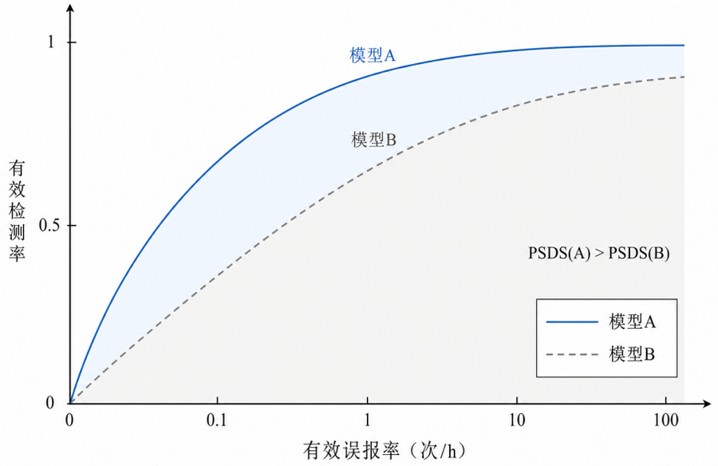
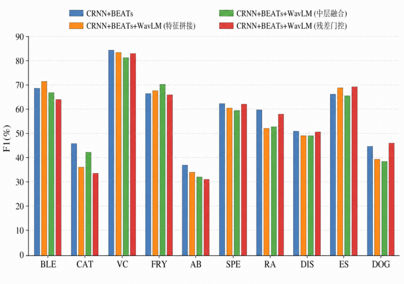

# DESED 声音事件检测实验结果

本文件汇总实验设定、评价指标、整体结果、类别级结果和融合方式对比。模型结构见 [体系结构说明](architecture.md)，运行方法见 [复现说明](reproduction.md)。

## 1 实验设定

实验使用 DCASE 2022 Task 4 的 DESED 数据集，涵盖 10 类室内声音事件：AB（Alarm bell ringing，闹钟或铃声）、BLE（Blender，搅拌机）、CAT（Cat，猫叫）、DIS（Dishes，杯碟碰撞）、DOG（Dog，狗叫）、ES（Electric shaver/toothbrush，电动剃须刀或牙刷）、FRY（Frying，煎炸声）、RW（Running water，流水声）、SPE（Speech，语音）和 VC（Vacuum cleaner，吸尘器）。

训练采用 `synth_only` 设定，训练集为带精确起止时间标注的合成数据，评估集为合成验证集。各模型使用相同的数据划分、解码器、损失函数和后处理流程。实验在单张 RTX 5090 上运行，随机种子为 42，每种结构训练一次。

表 1：实验环境

| 类别 | 配置项 | 参数 |
|---|---|---|
| 软件平台 | 操作系统 | Ubuntu 20.04 |
| 软件平台 | Python | 3.10.20 |
| 软件平台 | PyTorch | 2.7.1+cu128 |
| 硬件平台 | CPU | Intel(R) Xeon(R) Platinum 8470Q |
| 硬件平台 | 内存 | 90GB |
| 硬件平台 | GPU | RTX 5090 |
| 硬件平台 | 显存 | 32GB |

表 2：强标注数据的类别分布

| 类别 | 事件数 | 总时长（秒） | 平均时长（秒） | 事件数占比 | 总时长占比 |
|---|---:|---:|---:|---:|---:|
| AB | 1641 | 12747.0 | 7.77 | 10.39% | 13.31% |
| BLE | 704 | 6484.7 | 9.21 | 4.46% | 6.77% |
| CAT | 998 | 4792.5 | 4.80 | 6.32% | 5.00% |
| DIS | 2563 | 1567.9 | 0.61 | 16.23% | 1.64% |
| DOG | 1418 | 6238.5 | 4.40 | 8.98% | 6.51% |
| ES | 529 | 5483.0 | 10.36 | 3.35% | 5.72% |
| FRY | 986 | 8396.6 | 8.52 | 6.25% | 8.76% |
| RW | 1277 | 12111.9 | 9.48 | 8.09% | 12.64% |
| SPE | 4879 | 30283.6 | 6.21 | 30.91% | 31.61% |
| VC | 792 | 7693.4 | 9.71 | 5.02% | 8.03% |
| 合计 | 15787 | 95799.1 | 6.07 | 100.00% | 100.00% |

事件数占比以 15787 个事件为分母，总时长占比以 95799.1 秒为分母。两列均保留两位小数，分项舍入后相加可能与 100% 相差 0.01 个百分点。SPE 的事件数和总时长均为最高。DIS 的事件数位居第二，但平均时长仅为 0.61 秒，因此其总时长占比为 1.64%。

## 2 评价指标

Event-F1 衡量完整事件的检出能力。预测类别正确，并且起止时间误差满足容差要求时，该预测记为命中。该指标对事件碎片化、相邻事件合并和边界偏移较为敏感。

Inter-F1 使用基于交集的事件匹配规则，并在 DTC、GTC 等阈值约束下计算宏平均 F1。验证阶段对配置中的多个检测阈值结果取均值，带标签测试使用检测阈值 0.5。

PSDS（Polyphonic Sound Detection Score）汇总多个检测阈值和工作点下的性能。PSDS1 与 PSDS2 使用不同的评估参数，数值越高表示模型在相应误报范围内的综合检测性能越好。

## 3 整体结果

表 3 比较 3 种单分支模型和 2 种双分支模型。

表 3：单分支与双分支模型结果

| 模型 | PSDS1 | PSDS2 | Event-F1 (%) | Inter-F1 (%) |
|---|---:|---:|---:|---:|
| CRNN | 0.356 | 0.578 | 43.42 | 65.00 |
| BEATs | 0.465 | 0.780 | 52.65 | 65.80 |
| WavLM | 0.375 | 0.678 | 45.75 | 59.80 |
| CRNN+BEATs | 0.522 | 0.816 | 58.64 | 74.36 |
| CRNN+WavLM | 0.362 | 0.666 | 46.75 | 62.20 |

BEATs 单分支相对 CRNN 将 PSDS1 提高 0.109，将 PSDS2 提高 0.202，并将 Event-F1 提高 9.23 个百分点。WavLM 单分支的 Event-F1 为 45.75%，相对 CRNN 提高 2.33 个百分点。

CRNN+BEATs 在表 3 的 4 项指标上均取得最高结果。相对 CRNN，该模型的 PSDS1 提高 0.166，PSDS2 提高 0.238，Event-F1 提高 15.22 个百分点。CRNN+WavLM 的 Event-F1 为 46.75%，低于 CRNN+BEATs 的 58.64%。这些结果表明，CRNN 与 BEATs 在当前数据设定下具有更强的互补性。

## 4 类别级结果

表 4 展示 6 种结构在各类别上的 Event-F1。最后一行对应三分支特征拼接结构。

表 4：各类别 Event-F1（%）

| 模型 | RW | AB | VC | DOG | BLE | FRY | DIS | CAT | SPE | ES |
|---|---:|---:|---:|---:|---:|---:|---:|---:|---:|---:|
| CRNN | 49.5 | 21.1 | 68.3 | 32.8 | 43.1 | 65.9 | 28.6 | 29.9 | 46.9 | 48.4 |
| BEATs | 52.0 | 35.9 | 78.5 | 41.6 | 47.8 | 60.7 | 46.1 | 42.5 | 59.7 | 61.6 |
| WavLM | 49.1 | 20.6 | 63.1 | 42.8 | 45.3 | 68.7 | 40.4 | 25.1 | 54.2 | 48.2 |
| CRNN+BEATs | 59.8 | 36.8 | 84.6 | 44.8 | 68.7 | 66.4 | 51.0 | 45.9 | 62.3 | 66.2 |
| CRNN+WavLM | 55.6 | 16.9 | 72.5 | 41.2 | 44.6 | 69.9 | 38.8 | 27.1 | 53.6 | 47.2 |
| CRNN+BEATs+WavLM | 52.2 | 34.0 | 83.7 | 39.3 | 71.3 | 67.5 | 49.1 | 36.0 | 60.5 | 68.8 |

BEATs 在 9 个类别上的 Event-F1 高于 CRNN，其中 DIS 从 28.6% 提升至 46.1%，AB 从 21.1% 提升至 35.9%。CRNN+BEATs 在 RW、AB、VC、DOG、DIS、CAT 和 SPE 上取得表中最高结果。CRNN+WavLM 在 FRY 上达到 69.9%，表明 WavLM 对持续性声学模式具有一定补充作用。

三分支特征拼接在 BLE、FRY 和 ES 上超过 CRNN+BEATs，分别达到 71.3%、67.5% 和 68.8%。该结构在其余 7 类上的结果较低，因此宏平均 Event-F1 从 58.64% 降至 56.25%。三分支结构的收益呈现明显的类别差异。

## 5 融合方式对比

三分支实验包含特征拼接、固定式中层融合和残差门控 3 种方式。特征拼接将 3 路特征拼接后交给 Merge MLP；固定式中层融合在中间表示上进行结构化组合；残差门控以 BEATs 表征为主路径，通过门控引入 CRNN 和 WavLM 特征。

表 5：三分支融合结果

| 模型 | PSDS1 | PSDS2 | Event-F1 (%) | Inter-F1 (%) |
|---|---:|---:|---:|---:|
| CRNN | 0.356 | 0.578 | 43.42 | 65.00 |
| CRNN+BEATs | 0.522 | 0.816 | 58.64 | 74.36 |
| 三分支特征拼接 | 0.486 | 0.750 | 56.25 | 77.53 |
| 三分支固定式中层融合 | 0.492 | 0.734 | 55.82 | 77.41 |
| 三分支残差门控 | 0.497 | 0.745 | 57.00 | 78.97 |

3 种三分支结构的 PSDS1、PSDS2 和 Event-F1 均低于 CRNN+BEATs。残差门控在三分支结构中取得最高的 PSDS1、Event-F1 和 Inter-F1，分别为 0.497、57.00% 和 78.97%。特征拼接的 PSDS2 最高，为 0.750。

图中的 `RA` 对应 `RW`（Running water，流水声）。残差门控在 ES 和 DOG 上分别达到 69.2% 和 46.0%，同时在 BLE、CAT 和 AB 上低于 CRNN+BEATs。不同类别呈现不同的融合收益。

## 6 结论与适用范围

CRNN+BEATs 在当前实验中取得最高的 PSDS1、PSDS2 和 Event-F1，说明局部时频特征与通用音频自监督表征具有较强互补性。WavLM 在 FRY、BLE 和 ES 等类别上提供局部增益，但 3 种三分支结构的整体 PSDS 和 Event-F1 均未超过 CRNN+BEATs。

实验采用单随机种子和单次训练，结果反映该次运行的表现。训练和评估均使用 DESED 合成强标签数据，结论适用于该数据设定。
